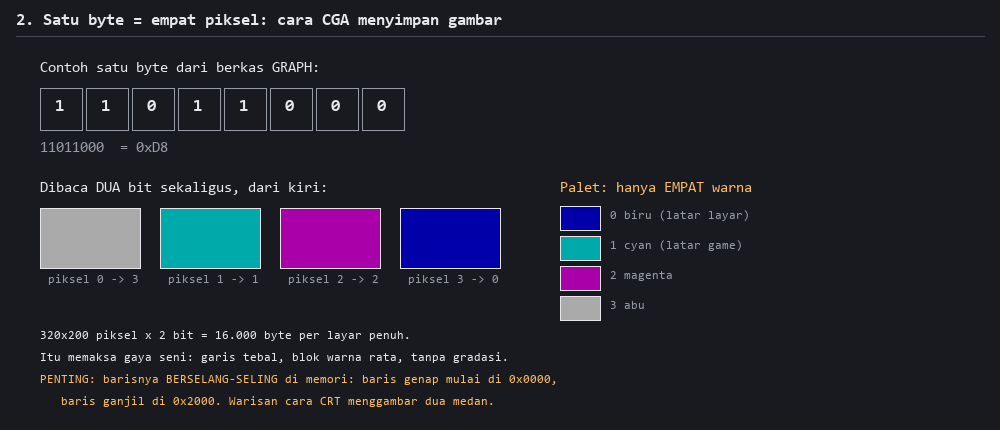
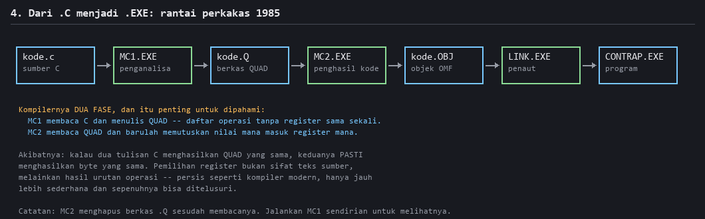

# Bagaimana Program Dirancang di Tahun 1985

### Membedah *Creative Contraptions* — studi kasus untuk yang sedang belajar pemrograman

---

Dokumen ini bukan katalog fitur. Ini pelajaran tentang **cara berpikir** seorang
programmer di tahun 1985, dibaca langsung dari programnya — bukan dari ingatan orang,
bukan dari tutorial, melainkan dari byte-nya sendiri.

Kenapa program setua ini layak dipelajari? Karena semua keputusannya **kelihatan**.
Program modern menyembunyikan pilihan desain di balik puluhan lapisan framework; di
sini seluruh program muat dalam 46 kilobyte dan setiap byte punya alasan. Ketika
sumber daya sangat sempit, desain yang buruk langsung terlihat. Yang bertahan adalah
yang benar-benar bekerja.

Semua angka di bawah **terverifikasi**: kami merekonstruksi ulang source C-nya sampai
`.EXE` hasil kompilasi identik byte-per-byte dengan aslinya. Kalau sebuah klaim di
sini salah, rekonstruksinya tidak akan cocok.

---

## 1. Mesinnya dulu: kenapa "kecil" itu bukan pilihan


**Penjelasan gambar.** Ini peta seluruh program di memori; angkanya dibaca langsung
dari `CONTRAP.MAP` hasil penautan. Empat blok, dan hanya itu:

- **BASE (14 byte)** — tanda tangan kompiler, teks `"MS-C  V 1.04  "`. Bahkan 14 byte
  ini punya tempat resmi di peta.
- **PROG (36.948 byte)** — *seluruh* kode: logika game dan rutin pustaka jadi satu.
- **DATA (9.556 byte)** — dinamai DGROUP: semua variabel global, tabel, dan teks.
- **STACK (256 byte)** — tumpukan. Dua ratus lima puluh enam byte, untuk seluruh program.

Yang perlu dipahami: pembagian ini **bukan gaya penulisan**, melainkan paksaan
perangkat keras. Prosesor 8086 mengalamati memori lewat **segmen 64 KB**. Kode diakses
lewat register CS, data lewat DS. Model memori "SMALL" yang dipakai game ini berarti
satu segmen kode dan satu segmen data — sehingga setiap alamat cukup 16 bit, dan
setiap instruksi jadi lebih pendek.

Konsekuensinya menjalar ke mana-mana. Tidak ada `malloc` untuk data game. Tidak ada
struktur yang tumbuh. Semua penyangga dipesan di muka dengan ukuran tetap, karena
batas atasnya sudah diketahui sejak awal.

> **Jebakan nyata yang kami alami.** DGROUP wajib mulai di batas paragraf (kelipatan
> 16). Rekonstruksi kami sempat menaruhnya di 0x9064 — meleset 12 byte. Akibatnya
> register DS menunjuk satu paragraf di bawahnya dan **setiap** alamat data bergeser 4
> byte. Gejalanya bukan crash: program tetap jalan, mencoba membuka berkas yang namanya
> sudah teracak, lalu keluar dengan tenang. Pelajarannya: pada sistem tanpa proteksi
> memori, kesalahan tata letak tidak berteriak — ia berbisik.

---

## 2. Gambar: empat warna, dan itu pun harus dihemat



**Penjelasan gambar.** Di atas: satu byte dari berkas `GRAPH`, nilainya `0xD8`. Di
bawahnya byte itu dipecah **dua bit sekaligus** dari kiri ke kanan, menghasilkan empat
piksel berurutan. Tiap pasangan bit adalah indeks ke palet empat warna di kanan —
biru, cyan, magenta, abu.

Satu byte = empat piksel. Layar 320×200 = 16.000 byte, seperempat memori yang tersedia
untuk seluruh program.

Perhatikan apa yang dilakukan keterbatasan ini pada **seni**-nya: garis tebal, blok
warna rata, tanpa gradasi, tanpa anti-aliasing. Gaya visual game era ini sering dikira
selera zaman. Sebenarnya itu konsekuensi aritmetika.

Satu detail yang sering mengejutkan pemula: baris layar **tidak berurutan** di memori.
Baris genap mulai di offset 0x0000, baris ganjil di 0x2000 — warisan cara tabung CRT
menggambar dua "medan" berselang-seling. Kalau Anda menulis kode gambar dengan asumsi
`alamat = baris × lebar`, hasilnya gambar yang tersobek jadi dua.

---

## 3. Menyimpan data: arsip, bukan berkas per gambar


**Penjelasan gambar.** Satu entri direktori dari berkas `GRAPH`, dengan nilai sungguhan
dari record pertama. Dua belas byte, dan itu seluruh "basis data" game:

| offset | isi | catatan |
|---|---|---|
| +0 | `id` | jenis part; bit ke-7 dipakai sebagai penanda kelompok |
| +1 | `row` | nomor varian. **+100 berarti "bagian lanjutan"**, bukan varian baru |
| +2 | `h` | tinggi piksel |
| +3 | `w` | lebar piksel |
| +4 | `dy` | geser tegak, bertanda |
| +5 | `dx` | geser datar, bertanda |
| +6 | `len` | panjang blob terkompresi (2 byte) |
| +8 | `off` | posisi blob di dalam berkas (4 byte) |

Yang layak dipelajari adalah **kenapa bentuknya begitu**. Record dibaca langsung dari
disket ke memori lalu dipakai apa adanya — bentuk di berkas sama dengan bentuk di RAM.
Tidak ada parser, tidak ada penguraian, tidak ada alokasi. Program modern akan
menyimpannya sebagai JSON dan menguraikannya saat mulai; program ini tidak mampu
membayar biaya itu, jadi ia menghapus langkahnya sama sekali.

Perkalian `indeks × 12` muncul berulang di kode mesinnya. Begitu Anda mengenali polanya,
Anda bisa menebak "ini sedang mengakses tabel record" hanya dari bentuk instruksinya.

> **Jebakan nyata.** Kami sempat membaca `+4` sebagai `dx` dan `+5` sebagai `dy` —
> tertukar. Semua sprite tetap tergambar, hanya meleset beberapa piksel, jadi
> kesalahannya tidak mencolok. Baru ketahuan saat kami menyusun ulang layar dari data
> dan membandingkannya ke biner. "Kelihatan benar" bukan bukti.

### Kompresi yang sengaja dibuat bodoh


**Penjelasan gambar.** Sprite "Inclined Plane" di kanan. Di kiri: ukurannya di berkas
dibanding sesudah dibuka, potongan byte mentahnya, dan seluruh aturan kompresinya —
yang hanya ada dua baris:

```
E4 <jumlah> <nilai>   ->  ulangi <nilai> sebanyak <jumlah> kali
byte lain             ->  salin apa adanya
```

Itu saja. Namanya *run-length encoding*, dan ini bentuk paling sederhananya.

Pertanyaan bagus untuk pemula: kenapa tidak memakai kompresi yang lebih pintar?
Jawabannya mengajarkan cara berpikir yang benar tentang trade-off:

1. **Rutin pembukanya harus muat.** Dekompresor RLE cukup beberapa lusin byte assembly.
   Algoritma yang lebih pintar butuh tabel, dan tabel butuh RAM — RAM yang justru
   dibutuhkan untuk gambarnya sendiri.
2. **Harus cepat tanpa syarat.** Sprite dibuka saat game berjalan.
3. **Datanya memang cocok.** Gambar CGA empat warna penuh deretan byte identik; RLE
   menangkap hampir semua redundansi yang ada.

Pelajaran umumnya: **algoritma terbaik adalah yang paling cocok dengan datamu dan
anggaranmu**, bukan yang rasio kompresinya paling tinggi di makalah.

---

## 4. Perkakasnya: kompiler yang bisa dipahami seluruhnya



**Penjelasan gambar.** Perjalanan dari `.c` ke `.EXE`, tujuh langkah. Kotak hijau
adalah program yang dijalankan; kotak biru adalah berkas.

Bagian paling menarik: kompilernya — **Microsoft C 1.04**, yang sebenarnya Lattice C
yang di-rebrand — bekerja **dua fase**.

- **MC1** membaca C dan menulis berkas **QUAD**: daftar operasi yang sama sekali tidak
  menyebut register. Ini yang sekarang disebut *intermediate representation*.
- **MC2** membaca QUAD, dan baru di sinilah diputuskan nilai mana masuk register mana.

Kenapa ini penting bagi yang sedang belajar? Karena ia menjawab pertanyaan yang
membingungkan pemula: **kenapa dua kode yang "sama saja" bisa menghasilkan mesin yang
berbeda?** Yang menentukan bukan teks sumbernya, melainkan urutan operasi yang sampai
ke fase kedua. Kalau dua tulisan menghasilkan QUAD yang sama, keduanya pasti
menghasilkan byte yang sama.

Kompiler modern melakukan hal serupa, hanya dengan belasan fase optimasi di antaranya.
Prinsipnya tidak berubah sejak 1983.

Selama rekonstruksi, pemahaman ini berubah dari teori jadi alat kerja. Contoh nyata:
sebuah **label C yang tidak pernah dituju `goto` mana pun** tidak memancarkan satu byte
pun, tetapi memaksa kompiler menutup blok dasar di titik itu — semua nilai yang menunggu
disimpan langsung dituliskan ke memori dan registernya bebas. Satu label, nol byte, dan
kode yang dihasilkan berubah. Itu bukan trik; itu konsekuensi langsung dari cara fase
kedua bekerja.

---

## 5. Lima keputusan desain yang masih relevan

### 5.1 Data mengendalikan program, bukan sebaliknya


**Penjelasan gambar.** Satu layar game dengan panah ke sumber tiap bagiannya. Kiri:
layar seperti dilihat pemain. Kanan: dari berkas mana tiap elemen datang.

- **CONTRAP** menyimpan *susunan* — untuk tiap tujuan, daftar komponen `(y, x, jenis)`.
- **GRAPH** menyimpan objek "zany", hiasan yang sudah terpasang.
- **MECHS** menyimpan 15 mekanisme yang harus dipilih pemain.
- **MISC** menyimpan potongan antarmuka tetap — corong di puncak layar, misalnya.
- Kotak abu adalah slot kosong, digambar satu panggilan `fillrect`, bukan sprite.

Posisi akhir di layar = posisi di CONTRAP **ditambah** geser `(dx, dy)` dari record
sprite-nya. Pemisahan dua tingkat ini terlihat berlebihan sampai Anda sadar gunanya:
satu objek bisa dipakai ulang di banyak tujuan, dan penyelarasan halusnya diatur sekali
di record, bukan diulang di tiap tempat.

Inilah yang sekarang disebut **arsitektur berbasis data**. Kode game tidak tahu apa pun
tentang "goal 3"; ia hanya tahu cara membaca daftar dan menggambar. Menambah tujuan
berarti mengubah data, bukan menyentuh program. Di 1985 alasannya praktis — kode mahal,
data murah — tapi prinsipnya persis yang diajarkan hari ini.

### 5.2 "Fisika" yang ternyata bukan fisika

Bola yang menggelinding, memantul, dan mendorong benda terlihat seperti simulasi. Bukan.

Yang berjalan adalah **mesin virtual kecil** dengan **17 opcode**, membaca skrip dari
berkas `ANIMATE`. Tabel penyalurnya di `CS:0x23D4`. Tiap opcode satu `case` dalam satu
`switch` besar: gambar part, gerakkan sepanjang parabola, bunyikan nada, tunggu, ulangi.

Ini keputusan rekayasa yang cerdas. Simulasi fisika sungguhan di prosesor 4,77 MHz akan
lambat, sulit diprediksi, dan mustahil dijamin selalu menghasilkan animasi yang enak
dilihat. Dengan skrip, hasilnya **pasti**, **cepat**, dan **bisa didesain** — perancang
menentukan persis bagaimana tiap kontraption bergerak.

Pelajarannya: sebelum membangun sistem umum, tanyakan apakah yang Anda butuhkan
sebenarnya cuma **kepastian**. Simulasi memberi kemungkinan; skrip memberi kendali.

### 5.3 Assembly hanya di tempat yang benar-benar perlu

Dari 36.948 byte kode, sekitar **1.200 byte** ditulis tangan dalam assembly — bukan
karena programmernya tidak percaya kompiler, tetapi karena tiga jenis pekerjaan memang
tidak bisa diungkapkan dalam C 1985: penyalinan piksel ke memori layar, penangan
interupsi timer, dan akses port perangkat keras.

Sisanya — 97 persen — ditulis dalam C. Ini sikap yang sehat: optimasi manual dipakai di
tempat yang terukur, bukan di mana-mana.

### 5.4 Tabel menggantikan percabangan

Berulang kali, sesuatu yang bisa ditulis sebagai rantai `if` justru disimpan sebagai
tabel dan diakses lewat indeks. Penyalur opcode VM contohnya: alih-alih 17 perbandingan,
satu lompatan lewat tabel.

Di mesin lambat ini soal kecepatan. Tapi ada manfaat kedua yang bertahan sampai
sekarang: **tabel lebih mudah diubah daripada logika**. Menambah opcode berarti
menambah satu entri.

### 5.5 Menghindari alokasi sama sekali

Tidak ada satu pun `malloc` untuk data game. Semua penyangga global berukuran tetap.
Direktori arsip dibaca ke tabel berukuran tetap. Batas jumlah record adalah konstanta.

Bagi programmer modern ini terasa kaku. Tapi perhatikan apa yang hilang bersamanya:
tidak ada kebocoran memori, tidak ada fragmentasi, tidak ada kegagalan alokasi yang
harus ditangani, dan waktu jalannya bisa diprediksi. Sistem waktu-nyata dan perangkat
tertanam masih memakai disiplin yang sama hari ini, karena alasan yang persis sama.

---

## 6. Bagaimana kami tahu semua ini benar

Setiap klaim di dokumen ini bisa diperiksa — itu yang membedakannya dari tulisan
"sejarah komputer" biasa.

Kami menulis ulang source C game ini, mengompilasinya dengan **kompiler aslinya**
(Microsoft C 1.04 tahun 1983, dijalankan di dalam emulator DOS), lalu membandingkan
hasilnya dengan biner asli byte per byte:

```
python src_c/verify/execmp.py
  muatan  : asli 46.532 byte, kita 46.532 byte  (SAMA)
  cs:ip / ss:sp / nreloc : sama
  BEDA    : 1 byte
```

Satu byte yang berbeda adalah nilai sampah yang dipancarkan kompiler untuk sebuah
perbandingan `long` yang rusak. Nilainya adalah alamat memori internal kompiler saat ia
berjalan, jadi tidak ditentukan oleh sumber C sama sekali.

Program hasil rekonstruksi juga dijalankan berdampingan dengan aslinya di emulator pada
**24 skenario** (6 tujuan × 4 mode). Keduanya menghasilkan jejak eksekusi dan tangkapan
layar yang identik.

**Kenapa ini penting untuk dokumen belajar?** Karena tidak ada satu kalimat pun di sini
yang berasal dari tebakan. Kalau pemahaman kami tentang format record salah, gambarnya
tidak akan tersusun. Kalau pemahaman kami tentang tata letak memori salah, programnya
tidak akan jalan. Rekonstruksi yang cocok adalah bukti bahwa pembacaannya benar.

---

## 7. Kalau Anda ingin melanjutkan sendiri

Urutan yang kami sarankan untuk mempelajari program lama mana pun:

1. **Mulai dari data, bukan kode.** Format berkas jauh lebih mudah dipecahkan daripada
   instruksi mesin, dan begitu Anda paham datanya, kodenya jadi masuk akal.
2. **Cari yang berulang.** Perkalian dengan 12, konstanta yang muncul di banyak tempat,
   ukuran yang selalu sama — itu tanda tangan struktur.
3. **Bangun ulang, jangan cuma membaca.** Kesalahan pemahaman baru muncul saat Anda
   mencoba menghasilkan sesuatu. Membaca disassembly membuat Anda *merasa* paham;
   menghasilkan layar yang sama *membuktikan* Anda paham.
4. **Bandingkan ke sumber kebenaran, bukan ke asumsi sendiri.** Semua kesalahan terbesar
   di proyek ini terjadi karena membandingkan hasil dengan harapan, bukan dengan program
   aslinya.

Peta kode terperinci ada di **`CODE_MAP.md`**. Cerita game-nya — mode, skenario, dan
sejarahnya — ada di **`GAME_GUIDE.md`**.

---

## Lampiran A: inventaris berkas

| berkas | isi | ukuran / jumlah |
|---|---|---|
| `CONTRAP.EXE` | program, dimampatkan PKLITE | 25.548 byte (47.044 sesudah dibuka) |
| `GRAPH` | objek zany dan pemandangan | 562 record |
| `MECHS` | 15 tipe mekanisme | 30 record |
| `ANIMATE` | skrip animasi | 240 record |
| `MISC` | potongan antarmuka | 20 record |
| `CONTRAP` | susunan kontraption per tujuan | direktori 36 entri |

Wilayah kode game: `0x0082`–`0x69D7` (26.965 byte). Di atasnya, `0x69D7`–`0x9062`
(9.935 byte) terbukti berasal dari pustaka standar `MC.LIB` — 23 modul yang cocok
byte-per-byte, jadi tidak perlu direkonstruksi sama sekali.

## Lampiran B: catatan sejarah yang perlu diluruskan

- **Penerbit:** Bantam Electronic Publishing, © 1985.
- **Pengembang:** Looking Glass Software, Inc. ⚠ **Bukan** Looking Glass Studios
  (*System Shock*, *Thief*). Kesamaan namanya kebetulan; Looking Glass Studios berakar
  pada Blue Sky Productions (1990) dan Lerner Research, tanpa hubungan dengan Bantam
  maupun 1985. Rujukan: The Digital Antiquarian menyatakan eksplisit *"no relation to
  the later, much more famous Looking Glass Studios"*; MobyGames mencatat keduanya
  sebagai entitas terpisah.
- **Programmer:** **Jessie Ragsdale** — nama ini dipulihkan dari string di dalam biner
  ter-unpack (`Programmed by:  Jessie Ragsdale`) dan tidak tercatat di sumber publik
  mana pun sebelumnya.
- **Kompiler:** string `MS-C  V 1.04` ada di offset 0x200 biner ter-unpack. Microsoft C
  1.0x memang Lattice C yang di-rebrand Microsoft/Lifeboat pada 1983–84.
- **Model memori:** SMALL. Catatan lama menyebut "large" berdasarkan flag `0x2000` di
  header — itu salah baca: word di offset 0x1C bernilai `0x210F`, penanda **PKLITE
  v1.15**, properti packer dan bukan model memori. Bukti SMALL: hanya 4 entri relokasi,
  satu segmen kode untuk semua fungsi, dan crt0 menyetel DS/SS ke DGROUP terpisah dari CS.
