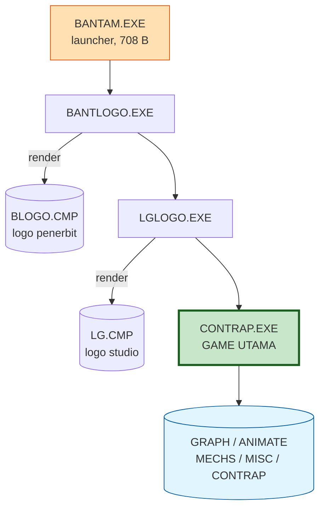
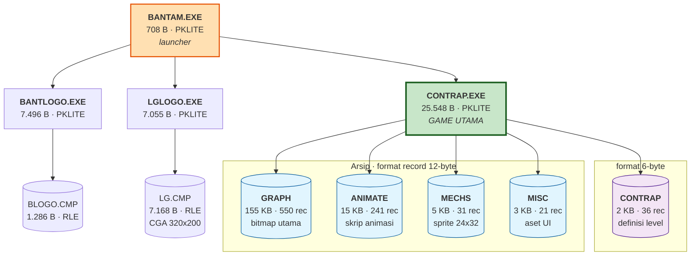

# Creative Contraptions (1985, Bantam Electronic Publishing) — Arsitektur Program

Dokumen ini hasil analisa statis (header + hex + validasi struktur lewat script) ditambah
hasil dekode aset. Belum ada satu byte pun kode yang di-disassemble, karena semua
executable masih terkompresi PKLITE.

## 🔑 TEMUAN KUNCI (update setelah dekode LG.CMP)

Layar logo `LG.CMP` berhasil didekode penuh dan menjawab tiga pertanyaan sekaligus:

1. **Developer: Looking Glass Software, Inc.** **[CONFIRMED]**
   > ⚠️ **KOREKSI.** Analisa awal saya menduga ini cikal-bakal Looking Glass Studios
   > (System Shock, Thief). **Dugaan itu SALAH.** The Digital Antiquarian menyatakan
   > eksplisit "no relation to the later, much more famous Looking Glass Studios"
   > ([filfre.net](https://www.filfre.net/2018/06/the-incredible-machine/)). MobyGames
   > mencatat keduanya sebagai entitas terpisah (ID 21615 vs ID 240), dan Wikipedia
   > Looking Glass Studios melacak asal-usulnya hanya ke Blue Sky Productions (1990) +
   > Lerner Research (merger 1992) — tanpa menyebut Bantam maupun 1985. **Kesamaan nama
   > ini kebetulan belaka.** Lihat `GAME_GUIDE.md` untuk detail.
2. **Publisher: Bantam Electronic Publishing, © 1985.** **[CONFIRMED]**
3. **COMPILER: Microsoft C V 1.04** (= Lattice C berlisensi). **[CONFIRMED — presisi]**
   Awalnya diduga "Lattice C" dari banner logo. Setelah `CONTRAP.EXE` di-unpack, biner
   menyimpan string literal **`MS-C  V 1.04`** di offset 0x200 — versi persis. Microsoft C
   1.0x memang Lattice C yang di-rebrand Microsoft (1983-84), jadi konsisten dengan banner
   (Microsoft + Lattice + Lifeboat), hanya kini lebih tepat.

   ### Model memori — KOREKSI 2026-07-29: SMALL, bukan large
   Catatan lama menyebut "large memory model" berdasarkan flag `0x2000` di header
   `CONTRAP.EXE`. Itu **salah baca**: word di offset 0x1c bernilai `0x210f` = penanda
   **PKLITE v1.15** (0x0f) + flag kompresinya — itu properti packer, BUKAN model memori C.
   Bukti langsung dari biner ter-unpack menunjuk **SMALL model**:
   - Hanya **4 entri relokasi** (large model butuh fixup segmen jauh lebih banyak).
   - **Satu segmen kode** — semua 144 fungsi di segmen yang sama (`functions.txt`), `CS:IP=0000:000e`.
   - crt0 @0x200: `mov ax,0x0907; mov ds,ax; mov ss,ax` → DS/SS = DGROUP terpisah dari CS
     (cocok dengan `DGROUP = LOAD_SEG + 0x907` di `work/emu.py`) = pola small model.
   - Hanya ~7 far-call di ±36 KB kode (sisanya near).
   Ini **konsisten** dengan MS-C 1.04: large model baru muncul di MS C 2.0. Kepastian final
   didapat saat kompilasi ulang benar-benar dicoba (lihat `DECOMPILE_PLAN.md` §3.0).

> ### 🔓 STATUS FASE 1: UNPACK BERHASIL
> `CONTRAP.EXE` sukses di-unpack dengan UNP 4.11 (PKLITE V1.15 standar → 25.548 jadi
> 47.044 byte). String asli kini terbaca. Temuan historis dari string:
> - **`Programmed by:  Jessie Ragsdale`** — nama pembuat, tak tercatat di sumber publik mana pun.
> - **6 nama contraption** lengkap (5 di antaranya sebelumnya hilang).
> - **`E4s in animate`** — kode game sendiri menyebut "E4", mengonfirmasi escape RLE 0xE4.
> - Referensi file: `misc`, `mechs`, `graph`, `animate`, `contrap` — konfirmasi 5 arsip aset.
> Detail lengkap di `GAME_GUIDE.md`.

Poin #3 menjawab pertanyaan terbuka #7 yang tadinya jadi *wildcard* terbesar proyek ini,
dan jawabannya menguntungkan: **ini kode C hasil compiler, BUKAN assembly tulisan tangan.**
Artinya ada runtime library standar yang bisa dikenali, dan pola prolog/epilog fungsi
konsisten. Untuk target byte-identical, compiler yang harus dicari sudah punya nama.

Setiap klaim di bawah diberi label:
- **[CONFIRMED]** — sudah diverifikasi secara numerik/aritmatik terhadap file.
- **[HIPOTESIS]** — dugaan kuat berdasarkan pola, tapi belum dibuktikan.
- **[OPEN]** — belum diketahui, perlu dijawab saat decompile.

---

## 1. Ringkasan eksekutif

Game ini bukan satu program monolitik. Ini adalah **4 executable kecil yang saling chaining**,
plus **5 file arsip aset ber-directory-table**, dengan grafis **CGA 4-warna ter-RLE**.

Yang paling penting untuk diketahui di depan:

> **`BANTAM.EXE` bukan game-nya.** Ukurannya hanya 708 byte dan isinya adalah launcher
> terkompresi PKLITE. Game sesungguhnya ada di **`CONTRAP.EXE` (25.548 byte)**.
> Keempat executable terkompresi PKLITE, jadi *tidak ada* kode asli yang bisa dibaca
> sebelum langkah dekompresi dilakukan.

---

## 2. Inventaris file

| File | Ukuran | Jenis | Peran |
|---|---|---|---|
| `BANTAM.EXE` | 708 B | MZ + PKLITE | Launcher / entry point **[CONFIRMED]** |
| `BANTLOGO.EXE` | 7.496 B | MZ + PKLITE | Penampil logo Bantam **[HIPOTESIS]** |
| `LGLOGO.EXE` | 7.055 B | MZ + PKLITE | Penampil logo "LG" (Lightning Gate?) **[HIPOTESIS]** |
| `CONTRAP.EXE` | 25.548 B | MZ + PKLITE | **Game utama** **[CONFIRMED sebagai target]** |
| `MODE.COM` | 6.485 B | flat .COM | Utilitas DOS `MODE` bawaan, bukan bagian game **[HIPOTESIS]** |
| `BLOGO.CMP` | 1.286 B | RLE bitmap | Aset logo Bantam **[HIPOTESIS]** |
| `LG.CMP` | 7.168 B | RLE bitmap | Aset logo LG **[HIPOTESIS]** |
| `GRAPH` | 155.286 B | Arsip | Arsip aset terbesar — grafis utama **[CONFIRMED format]** |
| `ANIMATE` | 14.799 B | Arsip | Data animasi **[CONFIRMED format]** |
| `MECHS` | 5.111 B | Arsip | Sprite mekanisme/komponen **[CONFIRMED format]** |
| `MISC` | 3.398 B | Arsip | Aset UI kecil (font/ikon) **[HIPOTESIS]** |
| `CONTRAP` | 2.376 B | Arsip (format lain) | Definisi contraption/level **[HIPOTESIS]** |
| `SETUP1/2.BAT` | — | Teks | Skrip bikin boot disk floppy **[CONFIRMED]** |

`SETUP1.BAT` dan `SETUP2.BAT` isinya identik secara fungsional: `sys a:`, copy `command.com`
dan `mode.*`, lalu jalankan `autoexec`. Ini artifak distribusi floppy 2-drive era 1985 —
menegaskan `MODE.COM` memang utilitas DOS yang ikut dibundel, bukan kode game.

---

## 3. Struktur executable

Keempat EXE punya sidik jari yang identik:

```
CS:IP  = fff0:0100        <- entry di segmen negatif (-16), khas stub PKLITE
relokasi = 1 entry        <- program asli pasti punya jauh lebih banyak
string "PKLITE Copr. 1990-92 PKWARE Inc. All Rights Reserved"
string "Not enough memory$"
```

**[CONFIRMED]** Semuanya PKLITE. Implikasi terpenting: **string dan kode asli tidak terlihat
sama sekali** dalam file di disk. Yang kita baca sekarang hanyalah decompressor stub-nya.

Anomali yang perlu dicatat:
- `BANTLOGO.EXE` punya **78 byte ekstra** setelah akhir image MZ (7.496 file vs 7.418 image).
  **[OPEN]** — bisa jadi data overlay, bisa juga padding.
- Header PKLITE `BANTAM.EXE` mengklaim `pages=2` (≈708 B) tapi minalloc besar → setelah
  dekompresi ukurannya akan bertambah signifikan.

### Rantai eksekusi

Di dalam stub `BANTAM.EXE` (offset ~0x280), string berikut terlihat sebagian karena tabel
literal PKLITE tidak seluruhnya terkompresi:

```
0x282: "bantl" .. "~ogo.exe"     -> bantlogo.exe
0x28e: "lg"    ..                -> lglogo.exe
0x296: "co" .. "rap"             -> contrap.exe
0x2a2: "stack "
```

**[HIPOTESIS kuat]** Alur program:



Kata `stack ` menunjukkan launcher juga mengurus alokasi memori/stack sebelum chaining
(konsisten dengan pesan `Not enough memory$`).

**[OPEN]** Mekanisme chaining-nya `EXEC` (INT 21h/4Bh) atau `EXIT` lalu di-chain oleh
batch? Tidak ada `AUTOEXEC.BAT` di folder ini padahal `SETUP*.BAT` memanggilnya — file
distribusi asli kemungkinan tidak lengkap. **[OPEN]** Perlu dikonfirmasi.

---

## 4. Format arsip aset — inti arsitektur data

Ini temuan terkuat dari analisa. `GRAPH`, `ANIMATE`, `MECHS`, `MISC` memakai format
**directory-table + blob** yang seragam.

### 4.1 Record directory (12 byte)

```c
struct AssetRecord {          // little-endian
    uint8_t  id_major;        // kategori aset
    uint8_t  id_minor;        // varian/frame dalam kategori
    uint8_t  height;          // tinggi, pixel
    uint8_t  width;           // lebar, pixel
    uint16_t flags;           // 0 di hampir semua record
    uint16_t length;          // panjang blob terkompresi, byte
    uint32_t offset;          // offset absolut blob dalam file
};
```

**[CONFIRMED]** — dibuktikan dengan dua uji independen:

1. **Uji self-consistency:** offset blob pertama dibagi 12 menghasilkan bilangan bulat
   persis di keempat file. Tabel directory berakhir tepat di titik blob pertama dimulai.

   | File | offset pertama | ÷12 | sisa |
   |---|---|---|---|
   | `GRAPH` | 6.600 | 550 | 0 |
   | `ANIMATE` | 2.892 | 241 | 0 |
   | `MECHS` | 372 | 31 | 0 |
   | `MISC` | 252 | 21 | 0 |

2. **Uji contiguity:** `offset[i] + length[i] == offset[i+1]`. Di `ANIMATE` dan `MISC`
   ini benar untuk **240/240** dan **20/20** record. Satu-satunya "pelanggaran" adalah
   record terakhir yang seluruhnya nol → **tabel diakhiri null-terminator record**.
   **[CONFIRMED]**

### 4.2 Bukti field width/height

`MECHS` sangat meyakinkan: **30 dari 31 record** punya `(height,width) = (24,32)` —
ukuran sprite seragam, persis seperti yang diharapkan untuk komponen mesin dalam game
puzzle. Record ke-31 adalah terminator nol. **[CONFIRMED]**

Rasio kompresi juga konsisten: 24×32 = 768 pixel → tersimpan hanya ~159 byte.
Pada CGA 2 bit/pixel, 768 pixel = 192 byte mentah → 159 byte artinya **RLE ringan**.
**[CONFIRMED bahwa blob terkompresi]**

### 4.3 Kasus khusus `ANIMATE`

Semua record `ANIMATE` punya `width = 4` dan `length == height`. Ini **bukan bitmap**.
**[HIPOTESIS]** `ANIMATE` menyimpan *skrip animasi*: `height` sebenarnya adalah jumlah
langkah/frame, dan blob-nya adalah rangkaian byte perintah. `width=4` kemungkinan tag
tipe, bukan lebar.

### 4.4 Anomali `GRAPH` — ✅ TERPECAHKAN

> ⚠️ **KOREKSI atas analisa awal saya.** Saya sebelumnya menulis "~60 KB tidak terjangkau
> oleh tabel". **Itu SALAH.** Kesalahannya: saya menyimpulkan dari uji contiguity, padahal
> record `GRAPH` **tidak berurutan menaik** — jadi "record terakhir berakhir di 95.376"
> tidak berarti apa-apa soal cakupan.

**Fakta terukur [CONFIRMED]:**
- **Coverage blob = 100,0%. Nol lubang.** Tidak ada byte yang tak terjangkau.
- **Nol record menunjuk ke luar file.**
- **121 offset dipakai oleh lebih dari satu record** ← **inilah penyebabnya.**

**Jawabannya: hipotesis #2 — blob di-share/dipakai ulang.** Satu bitmap dirujuk oleh
beberapa entri directory. 138 "pelanggaran contiguity" itu bukan kerusakan, melainkan
**penggunaan ulang yang disengaja** — optimasi disket yang masuk akal untuk 1985.
Hipotesis #1 (multi-section) dan #3 (salah tafsir field) **gugur**.

### 4.4b Frame animasi = *dirty rectangle* **[HIPOTESIS kuat]**

Saat frame-frame animasi dibentangkan jadi filmstrip, terlihat frame ke-2 dan seterusnya
**berukuran lebih kecil** dari frame pertama. Penafsiran: **frame 1 menyimpan gambar
penuh, frame berikutnya hanya menyimpan bagian yang berubah** (teknik *dirty rectangle*).

Ini menjelaskan tiga hal sekaligus secara ekonomis:
1. Kenapa ukuran frame dalam satu grup berbeda-beda
2. Kenapa 121 blob di-share (tambalan yang sama dipakai ulang)
3. Kemungkinan **arti field `flags`** ↓

### 4.4c Arti `flags` **[HIPOTESIS, belum diuji]**

Fakta [CONFIRMED]: record dengan `flags == 0` **selalu** terdekode tepat
(`decoded == (w/4)*h`). Record dengan `flags != 0` meleset **+4/+5 byte**. Jadi `flags`
jelas mengubah tafsir data.

**Hipotesis:** `flags` = **koordinat posisi tambalan**, dikemas sebagai `(y << 8) | x`.

Nilai yang teramati mendukung: `0x001E` → x=30,y=0 · `0x0015` → x=21,y=0 ·
`0x002A` → x=42,y=0 · `0x0C00` → x=0,y=12 · `0x0A00` → x=0,y=10.
Semuanya jatuh di rentang koordinat yang masuk akal untuk layar 320×200.

**[OPEN]** Perlu diuji: rekonstruksi animasi dengan menempel tambalan di `(x,y)` dari
`flags` di atas frame sebelumnya. Kalau animasinya mulus, hipotesis terbukti.
Dugaan awal saya bahwa `0xFF00` = "mask/atribut warna" **kemungkinan keliru** — lebih
cocok dibaca sebagai koordinat.

### 4.5 `CONTRAP` — format berbeda (6 byte)

`CONTRAP` **tidak** memakai record 12 byte. Yang cocok adalah **6 byte**:

```c
struct ContrapEntry {
    uint16_t id;              // 1,1,2,3,3,4,4,5,6,6,7,...  (menaik, ada duplikat)
    uint32_t offset;          // offset absolut, menaik monoton
};
```

**[CONFIRMED]** 216 ÷ 6 = 36 record pas, offset menaik monoton, diakhiri record nol.

**[HIPOTESIS]** Ini **definisi contraption / level**. `id` yang berulang (1,1,2,3,3,4,4)
menunjukkan pengelompokan — mungkin tingkat kesulitan atau kategori mesin, dengan
beberapa varian per grup.

---

## 5. Subsistem grafis

**[HIPOTESIS kuat]** Target hardware: **CGA 320×200, 4 warna, 2 bit/pixel**.

Bukti dari `BLOGO.CMP` dan `LG.CMP`: byte yang dominan adalah `aa bf fe ff 55 7f f5 7d`.
Dalam biner, `0xAA = 10101010` dan `0x55 = 01010101` — ini pola berulang 2-bit klasik
CGA. Kombinasi dengan tahun rilis 1985 dan kehadiran `MODE.COM` (untuk set mode display)
membuat CGA hampir pasti.

### Skema RLE

`BLOGO.CMP` diawali `e4 18 aa bf e4 16 ff fe bf ...`

**[CONFIRMED]** `0xE4` adalah **escape byte RLE**, diikuti `<count> <value>`.
Dibuktikan lewat uji lakmus: dekode `LG.CMP` dengan aturan ini + interleave CGA
menghasilkan **layar logo Looking Glass yang terbaca sempurna oleh mata manusia**.
Sebuah aturan yang salah tidak mungkin menghasilkan teks yang terbaca.

Layout framebuffer CGA yang terkonfirmasi untuk `LG.CMP`:
```
0x0000..0x1F3F  bank 0 = baris genap (0,2,..198)  100 x 80 byte = 8000
0x1F40..0x1FFF  padding 192 byte
0x2000..0x3F3F  bank 1 = baris ganjil (1,3,..199) 8000 byte
total 16384
```
Palet: CGA palette 1 high-intensity (hitam / cyan / magenta / putih). **[CONFIRMED]**

Aturan detail:
- `e4 18 aa` → ulang `0xAA` sebanyak 0x18 (24) kali
- `e4 16 ff` → ulang `0xFF` sebanyak 0x16 (22) kali
- byte lain (`bf`, `fe`) = literal

Skema ini juga muncul di `LG.CMP` (`e4 ff 55` → 255× `0x55`) dan konsisten dengan rasio
kompresi blob di `MECHS`. **[OPEN]** Perlu diverifikasi dengan decoder yang menghasilkan
gambar masuk akal.

Catatan: `LG.CMP` diawali `01 01` sebelum data RLE, sedangkan `BLOGO.CMP` langsung mulai
dengan `e4`. **[OPEN]** `LG.CMP` mungkin punya header 2 byte.

---

## 6. Peta arsitektur



---

## 7. Daftar pertanyaan terbuka

Ini yang harus dijawab oleh proses decompile:

1. ~~**[OPEN]** Kenapa 60 KB `GRAPH` tidak terjangkau?~~ ✅ **TERJAWAB — premisnya salah.**
   Coverage sebenarnya **100%**. Penyebab pelanggaran contiguity: **121 blob di-share**
   antar record. Lihat §4.4.
2. **[HIPOTESIS baru]** `flags` di `GRAPH` = koordinat tambalan `(y<<8)|x` untuk animasi
   *dirty rectangle*. Lihat §4.4c. **Belum diuji.**
3. ~~**[OPEN]** Apakah `0xE4` benar escape RLE?~~ ✅ **TERJAWAB** — ya, `0xE4 <count>
   <value>`, terbukti lewat render `LG.CMP`. Sisa: dekode `LG.CMP` menghasilkan 16.546
   byte, **162 byte lebih banyak** dari framebuffer CGA (16.384). Gambarnya sudah benar,
   jadi selisih ini kemungkinan trailing data / detail kecil aturan count. **[OPEN kecil]**
4. **[OPEN]** Chaining pakai INT 21h/4Bh (EXEC) atau exit-and-chain?
5. **[OPEN]** 78 byte ekstra di `BANTLOGO.EXE` itu apa?
6. **[OPEN]** `ANIMATE` benar skrip animasi? Apa opcode-nya?
7. ~~**[OPEN]** Compiler apa yang dipakai?~~ ✅ **TERJAWAB — Lattice C** (era 1983/84,
   setara Microsoft C 2.x). Lihat §Temuan Kunci. Sisa pertanyaan: **versi persisnya yang
   mana?** Ini yang menentukan bisa/tidaknya byte-identical. **[OPEN, kritikal]**
8. **[OPEN]** `AUTOEXEC.BAT` yang dipanggil `SETUP*.BAT` tidak ada — apakah rilis ini
   tidak lengkap?

---

## 8. Batasan dokumen ini

Semua isi dokumen ini berasal dari **analisa statis file terkompresi**. Bagian
"format arsip" (§4) diverifikasi lewat aritmatika offset yang konsisten di ratusan record.

> **UPDATE (2026-07-18):** Bagian §3 (executable) tidak lagi "paling lemah" — EXE sudah
> di-unpack (PKLITE) & di-decompile penuh (Ghidra, 144 fungsi). Sekarang SUDAH diketahui:
> - **Game loop & 4 mode** (FUN main): Review Mechanisms (ensiklopedia), Fill in Mechanisms,
>   Fill in Zany Objects, Contraption Mix Up (berwaktu+skor). Lihat `CODE_MAP.md`.
> - **"Simulasi mesin/bola"** = **VM animasi ber-skrip** (FUN_1000_18db, 17 opcode
>   @CS:0x23D4, skrip dari file ANIMATE) — BUKAN physics engine. Gerak bola = interpolasi
>   parabola fixed-point (FUN_1000_2823), sudah di-port EKSAK.
> - **Model input**: keyboard (panah/ENTER/SPACE/ESC), poll via FUN_1000_1791/1814.
> - **Render CGA**: 320×200 2bpp interleave, blitter bermasker, sync retrace.
>
> Port Python (playable, 4 mode) di `port/`. Rincian terbaru: `CODE_MAP.md`,
> `RESUME_EXACT.md`, `GAME_GUIDE.md`. Yang masih belum: format save (bila ada).
