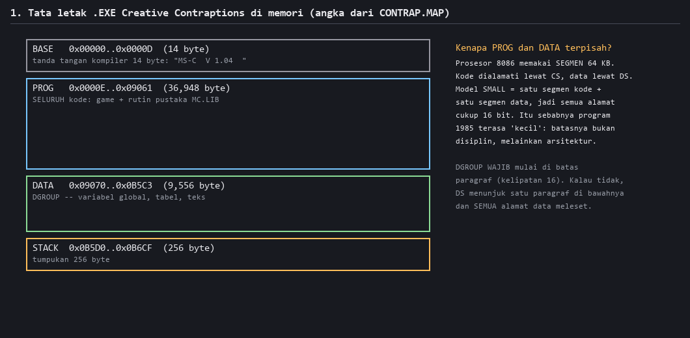
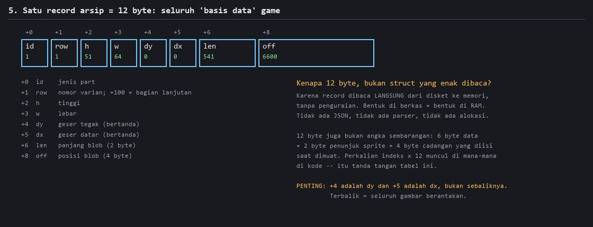
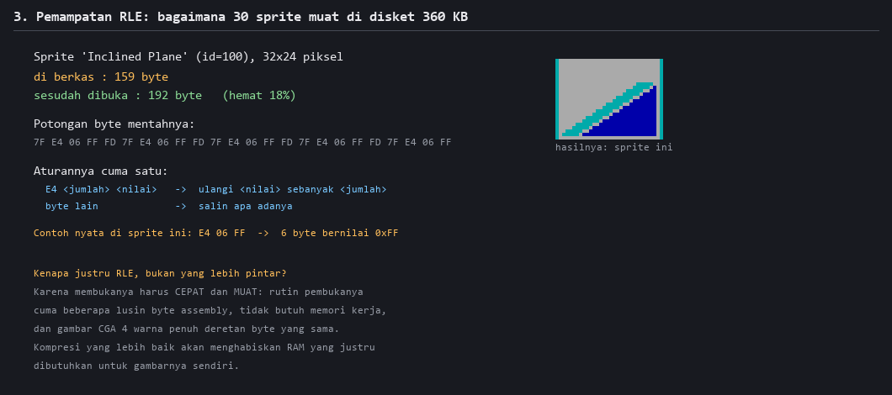
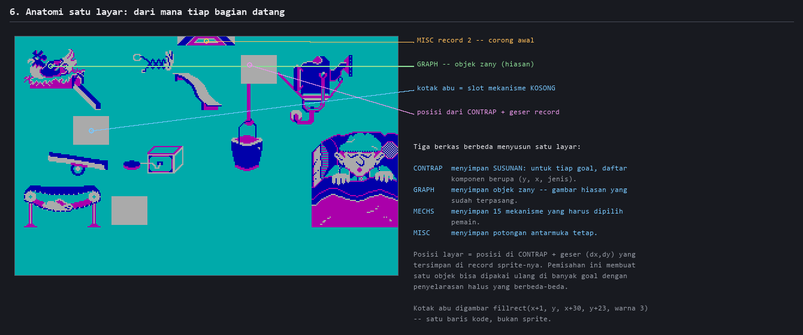
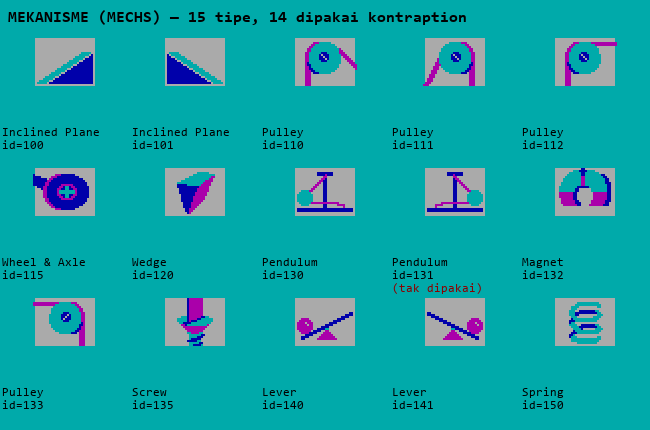
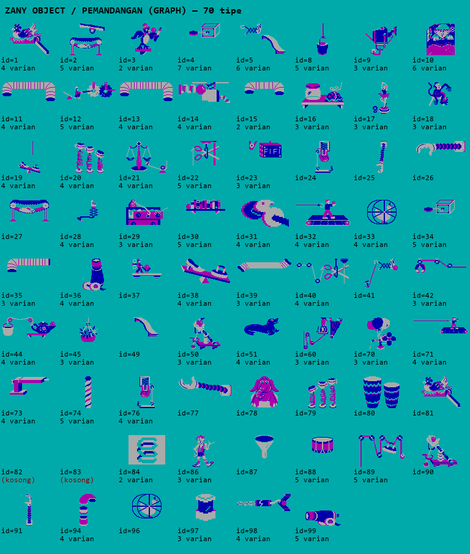

# Peta Kode — CONTRAP.EXE

### Panduan membaca sebuah program 1985 dari dalam, untuk yang sedang belajar

---

## Cara membaca peta ini

Dokumen ini memetakan seluruh program *Creative Contraptions*: di mana tiap bagian
berada, apa yang dikerjakannya, dan **bagaimana kami tahu**.

Kalau `ARCHITECTURE.md` menjawab *"kenapa dirancang begitu"*, dokumen ini menjawab
*"apa isinya, persisnya di mana"*.

Beberapa hal yang perlu diketahui sebelum mulai:

- **Alamat ditulis seperti `0x42CA`.** Itu offset dari awal segmen kode. Fungsi biasanya
  disebut dengan alamat awalnya, karena program aslinya tidak menyimpan nama fungsi
  sama sekali — nama-nama di dokumen ini kami yang memberi, berdasarkan apa yang
  dikerjakan fungsinya.
- **Setiap klaim di sini terverifikasi.** Source C-nya sudah direkonstruksi sampai
  `.EXE` hasil kompilasi identik byte-per-byte dengan aslinya. Kalau sebuah pembacaan
  salah, rekonstruksinya tidak akan cocok.
- **Kalau ada yang masih dugaan, ditulis "dugaan".** Bagian terakhir dokumen ini
  mendaftar apa yang belum diketahui.

---

## 1. Program dalam satu gambar



**Penjelasan gambar.** Peta seluruh program di memori, angkanya dari `CONTRAP.MAP` hasil
penautan.

Untuk membaca peta kode, yang penting adalah blok **PROG** — 36.948 byte yang berisi
seluruh instruksi. Blok itu terbagi dua wilayah yang sifatnya sangat berbeda:

| wilayah | isi | perlu dipelajari? |
|---|---|---|
| `0x0082` – `0x69D7` | **kode game** — 26.965 byte | **ya, ini yang menarik** |
| `0x69D7` – `0x9062` | pustaka standar `MC.LIB` — 9.935 byte | tidak |

Wilayah kedua adalah `printf`, `open`, `read`, manajemen memori — rutin standar yang
ikut ditautkan dari pustaka kompiler. Kami membuktikannya dengan mencocokkan 23 modul
dari berkas `MC.LIB` asli ke biner game **byte per byte**. Artinya sepertiga dari
program ini sama sekali bukan tulisan pembuat game-nya.

> **Pelajaran untuk pemula.** Saat membedah program apa pun, langkah pertama yang paling
> menguntungkan adalah **menyingkirkan kode pustaka**. Sepertiga pekerjaan hilang
> seketika, dan yang tersisa benar-benar milik penulis program.

Sebelum `0x0082` ada 130 byte **crt0** — kode rintisan yang dijalankan sebelum `main`.
Ia menyiapkan segmen, tumpukan, lalu memanggil `main`. Setiap program C punya ini;
biasanya tak terlihat karena kompiler menyisipkannya diam-diam.

---

## 2. Dari mana data datang

Program ini nyaris tidak menyimpan data di dalam dirinya sendiri. Hampir semuanya
dibaca dari lima berkas di disket.

| berkas | isi | jumlah record |
|---|---|---|
| `GRAPH` | objek zany dan pemandangan | 562 |
| `MECHS` | 15 id → 9 nama mekanisme | 30 |
| `ANIMATE` | skrip animasi | 240 |
| `MISC` | potongan antarmuka | 20 |
| `CONTRAP` | susunan kontraption per tujuan | direktori 36 entri |

### 2.1 Bentuk satu record



**Penjelasan gambar.** Satu entri direktori dari `GRAPH`, dengan nilai sungguhan.
Empat arsip pertama memakai bentuk yang persis sama — 12 byte per entri:

| offset | nama | isi |
|---|---|---|
| +0 | `id` | jenis part; bit ke-7 = penanda kelompok |
| +1 | `row` | nomor varian; **≥ 100 berarti "bagian lanjutan"** |
| +2 | `h` | tinggi piksel |
| +3 | `w` | lebar piksel |
| +4 | `dy` | geser tegak (bertanda) |
| +5 | `dx` | geser datar (bertanda) |
| +6 | `len` | panjang blob RLE (2 byte) |
| +8 | `off` | posisi blob di berkas (4 byte) |

Direktori dibaca berurutan sampai bertemu record dengan `id == 0`. Itu penandanya:
tidak ada penghitung jumlah di mana pun.

**⚠ Dua jebakan yang memakan waktu kami berjam-jam:**

1. **`+4` adalah `dy` dan `+5` adalah `dx`**, bukan sebaliknya. Tertukar berarti semua
   sprite meleset beberapa piksel — cukup halus untuk lolos dari pemeriksaan mata.
2. **Argumen `blit` berurutan `(sprite, Y, X, H, W)`** — koordinat tegak lebih dulu.
   Ini terbaca dari `drawslot` yang memanggil `blit(spr, y, x, 0x18, 0x20)` untuk sprite
   berukuran 32×24. Sekali Anda tahu ini, urutan `dy` sebelum `dx` jadi masuk akal.

### 2.2 Mencocokkan "jenis part" ke record

Ini bagian yang paling mudah salah, dan aturannya ada di fungsi `loadarc` (`0x531D`):

```c
if ((id & 0x7f) == tipe  ||  id == tipe)   /* KEDUANYA wajib */
```

**Kenapa dua perbandingan?** Karena `MECHS` memakai id 100–150. Untuk id ≥ 128, masker
`0x7f` mengubah 130 menjadi 2 — cocok dengan tipe yang salah. Hanya perbandingan penuh
yang menyelamatkannya. Kami sempat hanya memakai versi bermask, dan **semua mekanisme
id ≥ 128 hilang dari layar**.

### 2.3 Varian dan bagian

Fungsi `nvar` (`0x4094`) menentukan berapa varian yang tersedia untuk satu jenis part:

> Susuri direktori, ambil record yang cocok, dan **lewati yang `row`-nya sama dengan
> record sebelumnya**. Yang tersisa adalah varian.

Record dengan `row ≥ 100` bukan varian tersendiri, melainkan **bagian kedua** dari part
yang digambar sebagai dua sprite. `place` (`0x4E3E`) menyusun rantainya: record awal,
lalu record berikutnya yang `id`-nya sama dan `row == awal.row + 100`.

### 2.4 Kompresi



**Penjelasan gambar.** Satu sprite: ukurannya di berkas, ukurannya sesudah dibuka,
potongan byte mentahnya, dan seluruh aturan dekompresinya.

```
E4 <jumlah> <nilai>   ->  ulangi <nilai> sebanyak <jumlah> kali
byte lain             ->  salin apa adanya
```

Escape `0xE4` bukan tebakan: program ini sendiri memuat teks kesalahan
`"E4s in animate"`. Konstanta `0xE4` **tidak** muncul di kode gambar mana pun — artinya
sprite didekode sekali saat dimuat ke penyangga, lalu di-blit mentah. Pemisahan yang
rapi antara "memuat" dan "menggambar".

### 2.5 Format `CONTRAP` — berbeda sendiri

Berkas ini menyimpan susunan kontraption, dan bentuknya tidak seperti keempat arsip lain:

```
Direktori (216 byte): 36 × { u16 id, u32 offset }
   id 1..6  = enam kontraption; id berulang = varian
   id 7     = sembilan demo mekanisme (mode Review)
   id 128   = layar judul
   id 0     = slot kosong

Per kontraption @offset:
   u16  goal_id            ; diperiksa terhadap tujuan yang dipilih
   u16  countA ; u32[countA]
   u16  countB ; rec6[countB]   <- MEKANISME  { u16 y, u16 x, u16 jenis }
   u16  countC ; rec6[countC]   <- OBJEK ZANY { u16 y, u16 x, u16 jenis }
   u16[countB+countC]
```

⚠ Perhatikan urutannya: **`y` dulu, baru `x`.** Konsisten dengan urutan argumen `blit`.

Bagian `countA` masih **dugaan** — panjangnya diketahui pasti (karena parsingnya berhasil
di keenam tujuan), tetapi maknanya belum. Dugaan terkuat: data jalur bola.

---

## 3. Anatomi satu layar



**Penjelasan gambar.** Satu layar mode *Fill in Mechanisms*, dengan panah ke sumber tiap
bagiannya.

Alurnya, dari data ke piksel:

1. **`loadcon` (`0x5035`)** membaca `CONTRAP`: cari entri yang `id`-nya cocok dengan
   tujuan yang dipilih, undi salah satunya kalau ada beberapa, baca blob-nya.
2. **`loadarc` (`0x531D`)** membaca direktori `GRAPH` dan `MECHS`, menyaring record yang
   jenisnya dipakai kontraption ini.
3. **`pickpart` (`0x131A`)** mengundi varian untuk tiap slot, lalu memanggil `place`.
4. **`place` (`0x4E3E`)** menyusun tabel slot 12-byte dan memuat data sprite-nya.
5. **`drawslot` (`0x3F0F`)** menggambar isi tiap slot.

Rumus posisinya sederhana dan berlaku di mana-mana:

```
posisi layar = posisi di CONTRAP  +  (dx, dy) dari record sprite
```

Slot yang **belum diisi** tidak menggambar sprite sama sekali — ia memanggil:

```c
fillrect(x + 1, y, x + 0x1e, y + 0x17, 3);   /* blok penuh 30x24, warna 3 */
```

Itulah kotak abu yang Anda lihat di layar. Satu baris kode.

**⚠ Pemulihan tanda punya DUA ambang, dan keduanya benar di tempatnya:**

| jalur | ambang | fungsi |
|---|---|---|
| penempatan statis (layar design) | `>= 0x80` | `pickvar`, `place` |
| menggambar dari skrip animasi | `>= 0xC8` | `f278e` |

Memakai `0xC8` untuk penempatan statis membuat empat part mendarat di luar layar.
Contohnya zany tipe 71 di tujuan 3 punya `dx = 155`: dengan ambang `0x80` nilainya
menjadi −101 (196 − 101 = 95, cocok dengan biner), dengan `0xC8` tetap +155.

> **Pelajaran umum.** Dua bagian program yang terlihat mengerjakan hal sama belum tentu
> memakai aturan yang sama. Jangan menyeragamkan tanpa memeriksa.

---

## 4. Alur program

```
crt0 (0x000E)
  └─ main (0x0082)
       ├─ layar judul          <- CONTRAP goal 128, bola memantul (bounce, 0x2504)
       ├─ menu utama           <- runmenu (0x34CC)
       ├─ mode 1 Review        <- review (0x3C4F), demo dari CONTRAP goal 7
       ├─ mode 2 Fill Mech     <- pickpart -> runfill -> pickvar
       ├─ mode 3 Fill Zany     <- setzany (0x1200) lebih dulu
       └─ mode 4 Mix Up        <- setmark (0x10FD) + timer + skor
```

### Hierarki menu

Selesai bermain atau menekan ESC **tidak** kembali ke menu utama, melainkan ke **layar
pemilihan tujuan**. Untuk kembali ke menu utama, ESC harus ditekan sekali lagi. Detail
kecil, tapi salah menirunya membuat navigasinya terasa keliru.

### Dua sumber keacakan

Layar awal untuk tujuan yang sama tidak pernah sama persis, dan penyebabnya dua hal yang
terpisah:

1. **Varian struktur diundi** — `loadcon` menghitung berapa entri `CONTRAP` yang `id`-nya
   cocok, memilih satu secara acak, dan **menghindari mengulang varian sebelumnya**
   (disimpan di `0x1E30`).
2. **Palet part dikocok** — `mkpal` (`0x3909`) mengocok daftar part yang ditawarkan
   dengan algoritma Fisher–Yates, termasuk part pengecoh.

Pemisah antar-mode yang penting agar tidak tertukar:

| fungsi | dipakai di | tugas |
|---|---|---|
| `setmark` (`0x10FD`) | **hanya** mode 4 | mengundi slot mana yang dikosongkan |
| `setzany` (`0x1200`) | **hanya** mode 3 | kembarannya untuk objek zany |
| — | mode 2 | tidak memakai keduanya; semua slot mekanisme dikosongkan |

---

## 5. Subsistem gambar

Semua fungsi gambar memakai interleave CGA yang sama (`^0x2000`, `+0x50`). **Semuanya
menerima koordinat eksplisit sebagai parameter** — tidak ada penempatan tersembunyi.
Itu kabar baik bagi siapa pun yang ingin menyusun ulang layarnya.

| alamat | peran | parameter |
|---|---|---|
| `0x672F` | **blit sprite** | `(sprite, y, x, h, w)` |
| `0x6869` | **fillrect** | `(x0, y0, x1, y1, warna)` |
| `0x5CBB` | garis/span ber-XOR | `(x1, y1, x2, y2, warna)` |
| `0x6453` | teks (font 8×8) | `(string, x, y, skala_w, skala_h, …)` |
| `0x6524` | blok kecil bermasker 8×12 | `(mask, data)` |
| `0x5D98` / `0x5DA1` | tunggu vertical retrace | — |
| `0x5DCE` | geser layar ke kiri | `(y, x, h, w, 1)` |
| `0x6600` | geser layar ke kanan | `(y, x, h, w, −1)` |

**⚠ Sprite digambar OPAQUE.** Blitter `0x672F` menulis **semua** piksel, termasuk yang
berwarna cyan. Cyan adalah warna latar game, bukan penanda transparan. Menirunya dengan
*colorkey* akan melubangi bagian dalam sprite yang memang berwarna cyan — kesalahan yang
sempat kami buat dan butuh perbandingan piksel untuk ketahuan.

---

## 6. Mesin animasi

Gerak bola bukan simulasi fisika, melainkan **mesin virtual** dengan **17 opcode** yang
membaca skrip dari `ANIMATE`. Fungsi utamanya `0x18DB`.

Tabel penyalurnya ada di `CS:0x23D4`, berisi pasangan `{u16 opcode, u16 label}`. Tabel
ini **dihasilkan kompiler** dari sebuah `switch` — jadi tiap "handler" sebenarnya sebuah
`case`, bukan fungsi terpisah. Ini penting: mencarinya sebagai fungsi akan sia-sia.

| op | perilaku | operand |
|---|---|---|
| `0x00` | gambar daftar sprite (sampai `0xFF`) lewat `0x2714` | daftar |
| `0x01` | gambar daftar sprite lewat `0x278E` | daftar |
| `0x02` | suara / tunda | 1 byte |
| `0x03` | gerak, koordinat bertanda (ambang `0xC8`) | ≥ 2 byte |
| `0x05` | gambar kursor lewat `0x6524` | — |
| `0x06` | reset kursor | — |
| `0x07` | reset kursor + gambar satu sprite | — |
| `0x08` | gambar satu sprite lewat `0x2714` | — |
| `0x09` | gambar satu sprite lewat `0x278E` | — |
| `0x0A` | reset kursor + gambar + ulang | — |
| `0x0C` | gerak (mirip `0x03`) | ≥ 2 byte |
| `0x0D` | **mulai gelung** — simpan posisi skrip | word |
| `0x0E` | set penanda gelung | — |
| `0x0F` | kendali gelung + tunggu retrace | — |
| `0x10` | — | — |
| `0x11` | timer / skor | 4 byte |
| `0xFF` | akhir skrip | — |

(`0x0B` tidak ada.)

Tata bahasa dan panjang operan ini **terbukti cocok pada 68 dari 68 skrip** di keenam
tujuan, diverifikasi dengan menjalankan game di emulator dan membandingkan panjang skrip
yang benar-benar dibaca.

Interpolator geraknya (`0x2823`) menghasilkan lintasan parabola, dan port Python-nya
cocok **42 dari 42** kasus uji secara eksak.

---

## 7. Katalog fungsi yang sudah direkonstruksi

Semua yang di bawah ini sudah ditulis ulang dalam C dan **cocok byte-per-byte**.

| alamat | nama | ukuran | tugas |
|---|---|---|---|
| `0x0082` | `main` | 4.219 B | loop utama, menu, keempat mode |
| `0x10FD` | `setmark` | 259 B | undi slot yang dikosongkan (mode 4) |
| `0x1200` | `setzany` | 282 B | kembarannya untuk objek zany (mode 3) |
| `0x131A` | `pickpart` | 387 B | undi part untuk tiap slot |
| `0x18DB` | `animvm` | 3.040 B | mesin virtual animasi |
| `0x2504` | `bounce` | 398 B | bola memantul di layar judul |
| `0x2D11` | `runfill` | 383 B | loop mengisi jawaban per slot |
| `0x34CC` | `runmenu` | 547 B | loop menu |
| `0x3909` | `mkpal` | 634 B | bangun & kocok palet part |
| `0x3C4F` | `review` | 704 B | menjelajah mekanisme (mode 1) |
| `0x3F0F` | `drawslot` | 250 B | gambar isi tiap slot |
| `0x4094` | `nvar` | 566 B | hitung varian untuk satu jenis |
| `0x42CA` | `pickvar` | 1.730 B | pemilih varian untuk pemain |
| `0x4E3E` | `place` | 503 B | susun tabel slot, muat sprite |
| `0x5035` | `loadcon` | 739 B | muat kontraption dari `CONTRAP` |
| `0x531D` | `loadarc` | 226 B | muat direktori arsip |
| `0x53FF` | `load` | 262 B | muat satu blob sprite |

Selain ini ada 13 modul **assembly tulisan tangan** (~1.200 byte): blitter, fillrect,
penggeser layar, penangan interupsi timer, dan rutin suara. Ciri khasnya prolog yang
tidak lazim untuk kode C — misalnya `push bp; mov bp,sp; push es; push ds`.

---

## 8. Cara memeriksa sendiri

Semua yang ada di dokumen ini bisa Anda uji ulang.

```bash
# bangun ulang dari source C yang direkonstruksi
pwsh src_c/build/buildall.ps1
pwsh src_c/build/link.ps1

# bandingkan seluruh .EXE dengan biner asli
python src_c/verify/execmp.py -v
#   muatan  : asli 46.532 byte, kita 46.532 byte  (SAMA)
#   BEDA    : 1 byte  [artefak kompiler]

# tabel per fungsi + segmen data
python src_c/verify/verifyall.py

# susun ulang layar dari berkas aset, TANPA menjalankan game
python work/genscreens.py --verifikasi
#   blit tertangkap yang TERJELASKAN: 197/197 (100.0%)
```

Perintah terakhir itu yang paling meyakinkan sebagai bukti pemahaman: ia membaca
`CONTRAP`, `GRAPH`, `MECHS`, dan `MISC`, menerapkan aturan penempatan di bagian 3, dan
menghasilkan layar yang sama dengan yang dihasilkan game — tanpa mengeksekusi satu
instruksi pun dari program aslinya.

> **⚠ Satu alat yang wajib dijalankan sesudah setiap penautan: `execmp.py`.**
> Alat pembanding per-fungsi terpaksa memperlakukan slot relokasi sebagai *wildcard*
> (di berkas `.OBJ` alamatnya memang belum diisi). Akibatnya kode yang menunjuk **simbol
> yang salah** tetap dilaporkan "cocok". Membandingkan `.EXE` hasil penautan menemukan
> 24 byte seperti itu di empat fungsi yang semuanya berstatus "cocok byte-per-byte".
> Itu pelajaran metodologi yang mahal: **alat ukur punya titik buta, dan titik butanya
> harus ikut didokumentasikan.**

---

## 8b. Nama yang menyesatkan — dan cara menangkapnya

Nama global di dekompilasi ini kami sendiri yang memberi. Sebagian ternyata salah,
dan tiga di antaranya sempat menyesatkan berbulan-bulan. Ini pelajaran umum:
**dalam rekayasa balik, nama adalah hipotesis, bukan fakta.** Yang membuktikan
sebuah nama salah selalu *pemakaiannya*, bukan tampilannya.

| Nama | Isi sebenarnya | Yang membongkarnya |
|---|---|---|
| `bally` @0x25e | koordinat **X** | `setball(0, i*10)` menjajarkan ikon **mendatar** lewat argumen ini; `ballrow = y/4` = kolom byte CGA |
| `ballx` @0x260 | koordinat **Y** | `blend()` mengulang 8× di sini — itu jumlah **baris** sprite |
| `goal` @0x718 | **jumlah bola**, bukan nomor kontraption | `goal = 1` sebelum layar design, `goal = 6` di Contraption Mix Up, `goal++` saat pemain dapat bola |
| `mode_` @0x846, `seed` @0x72a | **pegangan berkas** | dipakai sebagai argumen pertama `read()`/`lseek()` |

Cara `goal` tertangkap layak diceritakan, karena bentuknya khas. Port menggambar
`goal` ikon bola di pita atas. Perbandingan piksel ke game asli memberi:

```
goal 1: 64000/64000     goal 4: 63850/64000
goal 2: 63950/64000     goal 5: 63800/64000
goal 3: 63900/64000     goal 6: 63750/64000
```

Persis **50 piksel per nomor goal**. Selisih yang tumbuh linier terhadap sebuah
variabel hampir selalu berarti variabel itu dipakai sebagai **hitungan**. Game
aslinya selalu menggambar satu ikon; yang salah bukan cara menggambar ikonnya,
melainkan angka yang kami suapkan. Kalau hanya melihat gambarnya, beda 50 piksel
di pojok kiri atas tidak akan pernah terlihat.

## 9. Yang masih belum diketahui

Daftar ini pendek, dan itu memang tujuannya.

1. ~~**Blok `countA` di `CONTRAP`**~~ — **TERPECAHKAN 2026-08-01.** Itu `postab`
   (@0x3b6): daftar posisi **label huruf**. Fungsi `f15d0()` menggambarnya:

   ```c
   for (i = 0; i < cnt; i++) { s = i + 'A';
       text(&s, tab[i*2+1], tab[i*2], 1, 1, 3); }
   ```

   Jadi tiap entri 4 byte = dua `int`, hurufnya `'A' + i`, warnanya 3. Perhatikan
   `text()` memakai urutan **(X, Y)** — kebalikan `blit()` yang **(Y, X)**; entri
   `(45, 0)` menaruh huruf `A` di `x=0, y=45`. Diperiksa terhadap ketujuh label
   yang terlihat di tangkapan VRAM, bukan diterka.
2. **Arti field `flags`** pada beberapa record arsip — sebagian record punya bit yang
   belum terpetakan perilakunya.
3. **Satu byte di `load+134`** (`0x5485`) tidak akan pernah cocok. Itu nilai sampah yang
   dipancarkan kompiler untuk perbandingan `long` yang rusak, dan nilainya adalah alamat
   memori internal kompiler saat berjalan. Sudah diukur: mengganti nama berkas sumber
   menggesernya di rentang `0x34`–`0x3A`, tak pernah mencapai `0x94` seperti aslinya.
   Batasnya ada di lingkungan build, bukan di sumber C.
4. **Bonus "menyelesaikan keenam kontraption tanpa kesalahan"** yang dijanjikan manual —
   nilainya belum ditemukan di kode.

---

## Lampiran: katalog part



**Penjelasan gambar.** Seluruh isi `MECHS`. Tiga angka yang perlu dibedakan:
**30 record** di berkas → **15 id** berbeda → **9 nama mekanisme**. Beberapa mekanisme
punya lebih dari satu bentuk (katrol menghadap dua arah, tuas miring dua arah), dan game
memilih bentuk yang cocok dengan posisinya.

Gunakan gambar ini sebagai kunci saat membaca dump `CONTRAP`: angka `jenis` di record
6-byte merujuk langsung ke id di sini.

⚠ **id 131 (Pendulum bentuk kedua) ADA di arsip tapi tidak dirujuk kontraption mana pun.**
Ditandai merah di gambar. Kemungkinan bentuk cadangan yang tidak jadi dipakai — sisa
proses pembuatan yang ikut terkirim.



**Penjelasan gambar.** **70 tipe** objek zany dan pemandangan yang benar-benar dirujuk
`CONTRAP` — termasuk yang hanya muncul di goal 7 (demo) dan goal 128 (layar judul).
Angka di bawah tiap gambar menunjukkan berapa **varian** yang tersedia untuk tipe itu;
itulah sebabnya satu tujuan bisa terlihat berbeda tiap kali dimuat.

Tiap gambar disusun dengan aturan **rantai** dari bagian 2.3 — kalau sebuah part terdiri
dari dua record (`row` dan `row+100`), keduanya ditempel pada geser masing-masing. Versi
katalog yang lama hanya menggambar record pertama, sehingga part seperti id 94 tampak
terpotong dan tidak cocok dengan layar yang dibangkitkan.

⚠ **id 82 dan 83 memang KOSONG** — masing-masing satu record 4×2 piksel yang seluruhnya
warna latar, dan id 83 benar-benar dipakai di layar judul. Ditandai merah supaya tidak
terbaca sebagai kesalahan render.

---

Cerita perancangannya ada di **`ARCHITECTURE.md`**. Sisi permainannya ada di
**`GAME_GUIDE.md`**.
