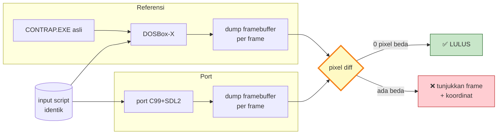
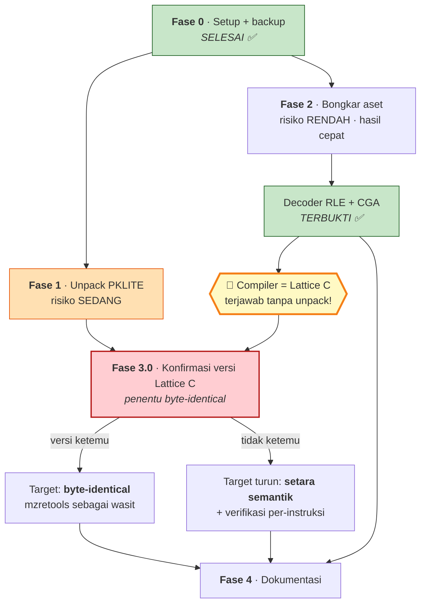

# Rencana Decompile — Creative Contraptions (1985)

Dokumen ini adalah **usulan**, bukan keputusan. Semuanya bisa diubah setelah kita diskusi.
Baca `ARCHITECTURE.md` dulu untuk konteks temuan.

---

## 0. Kondisi tooling di mesin ini (hasil cek)

| Tool | Status | Catatan |
|---|---|---|
| Python 3.11.9 (64-bit) | ✅ ada | Tulang punggung semua parser custom |
| Git | ✅ ada | Untuk clone mzretools |
| **Java** | ❌ **tidak ada** | **Ghidra butuh ini** — harus install JDK 21 dulu |
| **Compiler C/C++** (gcc/cmake/make) | ❌ tidak ada | **mzretools butuh ini** untuk di-build |
| DOSBox / DOSBox-X | ❌ tidak ada | Perlu download |
| radare2 / ndisasm / objdump | ❌ tidak ada | Alternatif disassembler |
| WSL | ⚠️ ada tapi kosong | Hanya `docker-desktop`, bukan distro Linux beneran |

**Implikasi penting:** dua tool yang Bapak sebut (mzretools dan Ghidra) **sama-sama belum
bisa langsung jalan**. mzretools perlu toolchain C++, Ghidra perlu Java. Ini bukan
blocker, tapi Fase 0 harus jadi langkah nyata, bukan formalitas. Saya minta persetujuan
sebelum install apa pun.

---

## 1. Prinsip yang saya usulkan

1. **Dekompresi dulu, apa pun yang terjadi.** Selama PKLITE belum dibuka, semua tool
   canggih tidak ada gunanya — mereka cuma akan menganalisa stub decompressor 200 byte,
   bukan game-nya.
2. **Aset dulu, kode belakangan.** Format arsip sudah 80% terpecahkan dari analisa statis.
   Menyelesaikannya duluan itu murah, cepat, dan hasilnya (gambar yang benar-benar muncul)
   menjadi **alat verifikasi** untuk menebak fungsi-fungsi di kode nanti.
3. **Verifikasi > asumsi.** Setiap hipotesis di `ARCHITECTURE.md` harus punya langkah
   pembuktian eksplisit. Kalau decoder RLE menghasilkan gambar sampah, hipotesisnya salah,
   bukan gambarnya yang "hampir benar".
4. **Emulator sebagai oracle.** DOSBox-X punya debugger internal. Ini satu-satunya cara
   melihat memori game *saat hidup* dan mencocokkannya dengan tebakan statis.
5. **Realistis soal hasil akhir.** Lihat §7.

---

## Fase 0 — Persiapan (butuh persetujuan Bapak)

**Tujuan:** menyiapkan lingkungan kerja + jaring pengaman.

1. Backup seluruh folder ke folder read-only. **Kita tidak pernah menyentuh file asli.**
   Semua kerja di atas salinan.
2. `git init` di folder kerja supaya setiap langkah ter-track dan bisa di-rollback.
3. Install yang perlu (**minta izin dulu, satu per satu**):
   - DOSBox-X (portable build, tidak perlu installer)
   - JDK 21 + Ghidra — *hanya jika* kita pilih jalur Ghidra
   - Toolchain C++ — *hanya jika* kita pilih jalur mzretools

**Output:** folder kerja bersih + tooling siap.
**Risiko:** rendah.

---

## Fase 1 — Dekompresi PKLITE 🔑

**Ini fase paling kritis. Kalau gagal di sini, seluruh proyek berhenti.**

Target: `BANTAM.EXE`, `BANTLOGO.EXE`, `LGLOGO.EXE`, `CONTRAP.EXE`.

Tiga jalur, saya urutkan sesuai preferensi:

| Jalur | Cara | Kelebihan | Kekurangan |
|---|---|---|---|
| **A. UNP / DISLITE** | Tool unpacker era DOS, jalan di DOSBox | Cepat, sekali jalan | Tool lawas, kadang gagal di varian PKLITE tertentu |
| **B. Dump dari memori** | Jalankan di DOSBox-X, breakpoint tepat setelah stub selesai, dump memori, rekonstruksi MZ | **Selalu berhasil** — stub-nya sendiri yang mendekompresi untuk kita | Perlu rekonstruksi header + tabel relokasi manual |
| **C. Unpack manual** | Tulis ulang algoritma PKLITE di Python | Terkontrol penuh, bisa di-audit | Paling lambat |

**Usulan saya: coba A dulu (30 menit), kalau gagal langsung B.**
Jalur B adalah jaring pengaman yang secara teori tidak bisa gagal, karena kita membiarkan
program itu sendiri yang membuka dirinya.

**Kriteria sukses yang terukur** (bukan "kelihatannya jalan"):
- Jumlah relokasi naik dari 1 → puluhan/ratusan
- `CS:IP` bukan lagi `fff0:0100`
- String ASCII asli muncul (nama file, teks menu, pesan error)
- **EXE hasil unpack benar-benar jalan di DOSBox-X**

**Risiko: SEDANG.** Ini titik kegagalan utama proyek.

---

## Fase 2 — Bongkar format aset (paralel, tidak tergantung Fase 1)

**Fase ini bisa dikerjakan sekarang juga**, karena tidak butuh dekompresi sama sekali.
Ini alasan kenapa saya taruh di depan.

1. Tulis `assets.py` — parser tabel 12-byte + 6-byte (struktur sudah terkonfirmasi).
2. Tulis decoder RLE `0xE4`, dekode ke CGA 2bpp, ekspor PNG.
3. **Uji lakmus:** buka `BLOGO.CMP`. Kalau logo "Bantam" terbaca oleh mata manusia →
   hipotesis RLE + CGA **terbukti sekaligus**. Kalau sampah → hipotesis salah, revisi.
4. Setelah decoder terbukti, dump semua: 550 `GRAPH` + 31 `MECHS` + 21 `MISC`.
5. **Serang anomali GRAPH** (60 KB tak terjangkau — lihat `ARCHITECTURE.md` §4.4):
   scan apakah ada tabel directory kedua di offset 95.376.
6. Pecahkan `ANIMATE` (skrip animasi) dan `CONTRAP` (definisi level).

**Output:** `assets.py` + folder PNG + spesifikasi format tertulis.
**Risiko: RENDAH.** Ini bagian dengan rasio hasil/usaha terbaik.

---

## Fase 3 — Rekonstruksi kode  *(diperbarui: compiler sudah teridentifikasi)*

**Status: pertanyaan compiler SUDAH TERJAWAB — Lattice C.** Lihat `ARCHITECTURE.md`
§Temuan Kunci. Ini didapat dari dekode layar logo, tanpa perlu unpack PKLITE.

Dampaknya besar dan positif:
- ✅ Ini **kode C hasil compiler, bukan assembly tulisan tangan** → wildcard terbesar
  proyek ini hilang. Ada pola prolog/epilog konsisten dan runtime library yang bisa
  dikenali & dinamai otomatis.
- ✅ Untuk byte-identical, target compiler sudah punya nama.
- ⚠️ Tapi muncul rintangan baru yang **spesifik untuk tujuan byte-identical Bapak**:
  **kita harus mendapatkan Lattice C versi yang tepat (era 1983/84, setara MS C 2.x).**
  Ini software komersial berumur 40+ tahun. Ketersediaannya bukan hal yang bisa saya
  janjikan sekarang, dan **ini kini jadi risiko nomor satu proyek**, menggantikan
  risiko PKLITE.

**Konsekuensi jujur:** byte-identical **berdiri atau jatuh** di ketersediaan Lattice C
yang cocok. Kalau versinya tidak ketemu atau tidak persis, hasil compile tidak akan pernah
byte-identical — sedekat apa pun logika kita. Kalau itu terjadi, saya sarankan turun ke
target "**setara secara semantik + terverifikasi instruksi per instruksi**" (mzretools
tetap berguna untuk ini), bukan memaksakan byte-exact.

### Langkah 3.0 — ✅ SELESAI (2026-07-29): compiler teridentifikasi DAN TERSEDIA
Risiko nomor satu di atas **sudah hilang**. Dua koreksi atas catatan lama:

1. **Versi persis = Microsoft C 1.04**, bukan sekadar "Lattice C". Bukti langsung: string
   literal `MS-C  V 1.04  ` di offset **0x200** biner ter-unpack (tepat sebelum crt0).
   MS C 1.0x memang Lattice C yang di-rebrand (Lifeboat Associates) — jadi catatan lama
   "Lattice C" tidak salah, hanya kurang presisi.
2. **Binernya TERSEDIA untuk diunduh** (dikoreksi dari "ketersediaan tidak bisa dijanjikan"):
   - PCjs — https://www.pcjs.org/software/pcx86/lang/microsoft/c/1.04/
     (2 disket: MC1.EXE/MC2.EXE = dua pass compiler, FXU.EXE, OMD.EXE; disk 2: LINK.EXE,
     LIB.EXE, MC.LIB, header STDIO.H/CTYPE.H/CONIO.H, contoh SIEVE.C — timestamp April 1983)
   - Internet Archive — https://archive.org/details/microsoft-c-compiler-1.04-1983-5.25-160k.-7z
     (2 image floppy 5.25" 160K; deskripsinya menegaskan MS C 1.0/2.0 = rebranded Lattice C
     milik Lifeboat, dan large model baru ada di 2.0)
3. **Model memori = SMALL** (lihat `ARCHITECTURE.md` §Model memori) — konsisten dengan
   MS C 1.04 yang memang belum punya large model. Catatan lama "large model" salah baca
   flag PKLITE.

**Konsekuensi:** jalur byte-identical **terbuka**. Verifikasi berikutnya = kompilasi
program uji kecil dengan MS C 1.04 di DOSBox, lalu cocokkan crt0 + pola prolog/epilog +
urutan fungsi library terhadap `CONTRAP_UNPACKED.EXE`. Baru setelah itu investasi besar.

Lalu, pilih jalur:

### Jalur 3A — mzretools *(sesuai saran Bapak)*
Filosofinya **verifikasi, bukan sekadar baca**: kita tulis ulang source, compile, lalu
mzretools membandingkan hasil compile dengan binary asli **instruksi per instruksi**.

- ✅ Memberi bukti matematis bahwa rekonstruksi kita **benar**, bukan cuma "mirip"
- ✅ Dirancang persis untuk kasus ini (DOS 16-bit real mode)
- ❌ Butuh build toolchain; butuh compiler era-1985 yang cocok untuk bisa byte-identical
- ❌ Proses lambat dan teliti

### Jalur 3B — Ghidra
- ✅ Decompiler ke pseudo-C, navigasi enak, analisa otomatis
- ✅ Bisa diberi anotasi progresif
- ❌ Dukungan x86 16-bit segmented **jauh lebih lemah** daripada 32/64-bit; output C-nya
  sering berantakan soal segment:offset
- ❌ Butuh Java

### Jalur 3C — DOSBox-X debugger
Bukan pengganti, tapi **pelengkap wajib**. Untuk melihat memori saat runtime,
trace INT 10h (video) / INT 21h (file), dan memvalidasi tebakan.

### **Keputusan Bapak: byte-identical → mzretools (3A) jadi pusat.**

Urutan final: **3A sebagai tujuan, 3B + 3C sebagai alat bantu.** Ghidra dipakai untuk
*memahami* kode dan Lattice C runtime, DOSBox-X untuk *membuktikan* pemahaman itu di
runtime, dan mzretools sebagai **wasit** yang memutuskan rekonstruksi kita benar atau
tidak.

**Klarifikasi scope byte-identical:** target realistisnya adalah identik dengan
**image CONTRAP.EXE hasil unpack**, bukan file .EXE di disk. Mereproduksi kompresi
PKLITE 1992 secara byte-exact adalah masalah terpisah yang tidak ada hubungannya dengan
kode game. Jadi Fase 1 tetap prasyarat mutlak, dan hasil unpack itulah "kebenaran" yang
dikejar mzretools.

---

## Fase 3B — JALUR PORT MODERN (usulan utama, menggantikan byte-identical)

> **Konteks keputusan:** Bapak menyatakan boleh pakai bahasa modern kalau Lattice C sulit
> didapat, **asalkan tampilan akhir persis sama dan aset tetap sama.**

### Ide inti: pindahkan sumbu pembuktian dari *byte* ke *pixel*

Tujuan asli byte-identical adalah **kesetiaan yang terbukti secara mekanis**, bukan
"kelihatannya mirip". Tujuan itu tetap kita pegang — hanya sumbunya yang digeser ke hal
yang benar-benar diminta:

| | Rencana lama | Rencana baru |
|---|---|---|
| Yang dibandingkan | Instruksi mesin | **Frame pixel** |
| Wasitnya | mzretools | **Frame-diff vs DOSBox-X** |
| Kriteria lulus | Byte identik | **Pixel identik** |
| Butuh Lattice C? | **Ya — blocker** | **Tidak** |
| Membuktikan | Kode kita sama | **Tampilan kita sama** ← yang Bapak minta |

Konsekuensi terbesar: **ketergantungan pada Lattice C hilang dari jalur kritis.** Risiko
nomor satu proyek ini lenyap. Kita tetap perlu unpack + decompile (untuk dapat logika),
tapi tidak perlu compiler 40 tahun.

### Tiga pilar kesetiaan

**1. Aset — setia *by construction*, bukan by effort**

Port membaca **file asli `GRAPH`/`MECHS`/`MISC`/`ANIMATE`/`CONTRAP` apa adanya saat
runtime**, lalu dekode RLE di memori. **Tidak ada konversi ke PNG, tidak ada re-encode.**

Ini penting dan sering disalahpahami: kalau kita ekspor ke PNG lalu port membaca PNG, kita
memasukkan satu langkah transformasi yang **bisa** menyimpang (palet, rounding, urutan
frame). Dengan membaca file asli langsung, aset identik **secara konstruksi** — mustahil
melenceng, karena bit-nya memang bit yang sama. PNG tetap dibuat, tapi hanya untuk
inspeksi manusia, bukan dipakai game.

**2. Renderer — emulasi CGA yang eksak**

Sudah terbukti di Fase 2 dan tinggal dipindah:
- 320×200, 2 bit/pixel
- Palet CGA 1 high-intensity (hitam/cyan/magenta/putih)
- Interleave bank 0x0000 / 0x2000
- Scaling **nearest-neighbor** (jangan pernah bilinear — akan mengaburkan pixel)

**3. Logika — direkonstruksi dari hasil decompile**

Ini satu-satunya bagian yang benar-benar butuh Fase 1 + Fase 3.

### Usulan bahasa: **C99 + SDL2**

Alasannya bukan nostalgia, tapi **traceability**:

- ✅ Struktur source bisa tetap **paralel dengan hasil decompile**, fungsi per fungsi.
  Kalau kita tulis ulang dengan gaya idiomatik modern (Rust/TS), kita **kehilangan
  kemampuan mencocokkan** kode kita dengan aslinya — padahal itu justru alat verifikasi
  terkuat kita.
- ✅ Bisa meniru semantik 16-bit dengan tepat (lihat jebakan di bawah).
- ✅ **Bonus:** C99+SDL2 bisa dikompilasi ke **WASM lewat Emscripten** → versi browser
  gratis, tanpa menulis ulang. Dapat native *dan* web sekaligus.

Alternatif: TypeScript+Canvas (mudah dibagikan, tapi semua angka di JS adalah *double* —
meniru overflow 16-bit jadi merepotkan dan rawan bug halus).

### ⚠️ Jebakan yang harus diantisipasi sejak awal

**1. `int` Lattice C = 16 bit. `int` C modern = 32 bit.** Ini jebakan port klasik dan
**paling berbahaya**, karena tidak bikin crash — dia diam-diam mengubah gameplay. Skor
yang harusnya *wrap* di 32.767 jadi tidak wrap; posisi yang harusnya melipat jadi lurus
terus. Bug yang muncul di menit ke-40 permainan. **Mitigasi: haram pakai `int` telanjang
di kode port — wajib `int16_t`/`uint16_t` eksplisit.**

**2. Timing.** Game 1985 sering terikat kecepatan CPU atau vertical retrace, bukan timer.
Perlu dipin ke frame rate tetap, dan ini harus diukur dari game asli di DOSBox-X.

**3. Aspect ratio — perlu keputusan Bapak.** CGA 320×200 di monitor 4:3 punya **pixel
non-persegi** (rasio ~1:1.2). Layar aslinya sedikit "gepeng" secara vertikal dibanding
320×200 apa adanya. "Persis sama" bisa berarti dua hal berbeda:
   - (a) 320×200 pixel-perfect (sesuai isi memori) — **rekomendasi saya**
   - (b) di-stretch ke 4:3 (sesuai penampakan di monitor CRT 1985)

   Ini pertanyaan terbuka, bukan hal yang boleh saya putuskan sendiri.

### Harness verifikasi — jantung jalur ini

Kedua sisi diberi **rekaman input yang sama persis**, lalu framebuffer dibandingkan.
Ini yang mengubah "kelihatannya mirip" jadi **klaim yang bisa diuji**. Tanpa harness ini,
"tampilan persis sama" cuma opini.

### Peran mzretools sekarang

Turun dari *deliverable* jadi **alat riset opsional**. Kalau Lattice C ternyata ketemu,
mzretools berguna untuk membuktikan **pemahaman kita atas logika aslinya sudah benar**,
sebelum kita port. Berguna, tapi **tidak lagi menghalangi**.

---

## Fase 4 — Dokumentasi & hasil akhir

- Spesifikasi format file yang lengkap
- Source beranotasi + peta fungsi
- Update `ARCHITECTURE.md` dengan temuan nyata (ganti semua [HIPOTESIS] jadi [CONFIRMED]
  atau koreksi yang salah)
- Asset viewer/extractor yang bisa dipakai ulang

---

## 5. Urutan kerja yang saya usulkan

Fase 2 sengaja dijalankan **berbarengan** dengan Fase 1. Kalau Fase 1 mentok, kita tetap
punya hasil nyata dari Fase 2 (semua grafis ter-ekstrak), bukan pulang dengan tangan kosong.

---

## 6. Yang perlu saya tanyakan sebelum mulai

1. **Tujuan akhirnya apa?** Ini mengubah seluruh strategi:
   - (a) **Paham cara kerjanya** → Ghidra + DOSBox-X, santai, cepat dapat insight
   - (b) **Source yang recompile jadi byte-identical** → mzretools jadi pusat, lambat & berat
   - (c) **Ambil aset + format file saja** → cukup Fase 2, selesai dalam hitungan jam
   - (d) **Bikin port/remake modern** → butuh (a) + (c), tapi tidak perlu (b)
2. **Boleh saya install** DOSBox-X, JDK+Ghidra, dan/atau toolchain C++? Yang mana saja?
3. **Prioritas:** mulai dari aset (hasil cepat) atau langsung serang PKLITE (inti masalah)?
4. Apakah Bapak punya **disk image asli** atau `AUTOEXEC.BAT` yang hilang itu?
   Rilis ini kemungkinan tidak lengkap (`ARCHITECTURE.md` §7 no.8).

---

## 7. Ekspektasi yang jujur

Saya lebih baik menyampaikan ini di depan daripada Bapak kecewa di tengah jalan:

- ✅ **SUDAH TERCAPAI:** format aset terpecahkan, decoder RLE+CGA terbukti, arsitektur
  program terpetakan, **compiler teridentifikasi (Lattice C)**.
- ✅ **Hampir pasti berhasil:** ekstraksi seluruh aset, spesifikasi format file.
- ⚠️ **Kemungkinan besar berhasil:** unpack PKLITE (jalur dump-memori sangat andal).
- ⚠️ **Realistis tapi butuh kerja keras:** rekonstruksi logika game, port pixel-perfect.
- ❌ **Tidak lagi dikejar:** byte-identical (lihat Fase 3B — digantikan pixel-identical,
  yang justru lebih sesuai tujuan Bapak dan menghapus ketergantungan Lattice C).
- ❌ **Jangan diharapkan:** source C asli dengan nama variabel dan komentar aslinya.
  **Itu tidak akan pernah kembali** — informasi tersebut hilang permanen saat program
  dikompilasi tahun 1985. Nama variabel apa pun yang muncul nanti adalah **karangan
  kita**, bukan milik programmer aslinya.
- ❓ **Wildcard:** kalau ternyata ini assembly tulisan tangan (bukan output compiler),
  Fase 3 jadi jauh lebih berat dan estimasi apa pun sebelum §Fase 3 langkah 1 adalah
  tebakan kosong.

**Catatan legal:** ini game 1985 yang sudah lama tidak beredar dan file-nya ada di mesin
Bapak sendiri. Reverse engineering untuk keperluan pribadi, preservasi, dan edukasi adalah
praktik yang wajar dan lazim. Yang perlu diingat: **aset dan kode hasil ekstraksi tetap
milik pemegang hak cipta** (Bantam Electronic Publishing / penerusnya). Kalau nanti ada
rencana publikasi atau distribusi, itu pertimbangan terpisah yang sebaiknya dipikirkan
sebelum, bukan sesudah.
