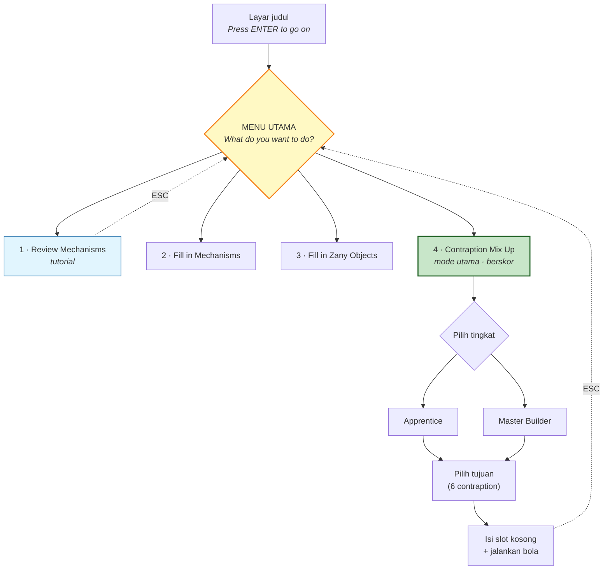

# Creative Contraptions (1985) — Panduan & Kisah Game

Dokumen ini disusun dari **tiga sumber independen**, dan setiap klaim ditandai asalnya:

| Tanda | Artinya |
|---|---|
| 🎮 | **Diamati langsung** — saya menjalankan game ini di DOSBox-X dan melihatnya sendiri |
| 📖 | **Manual asli** ([archive.org](https://archive.org/details/a2manual_Firebird_Creative_Contraptions_Manual)) |
| 🌐 | **Sumber web** (MobyGames, Digital Antiquarian, dll — URL disertakan) |
| 🔬 | **Analisa biner** — dari membedah file game |
| ❓ | **Tidak diketahui** — dicari, tidak ketemu |

> **Catatan kejujuran:** saya tidak punya pengetahuan bawaan tentang game ini — terlalu
> obscure. Semua isi dokumen ini didapat dengan cara diverifikasi, bukan diingat. Yang
> tidak bisa saya verifikasi, saya tulis "tidak ketemu" — bukan saya karang.

---

## 1. Ini game apa?

**Creative Contraptions** adalah game puzzle edukatif bertema **mesin Rube Goldberg** —
mesin rumit-berlebihan yang melakukan tugas sederhana lewat rantai reaksi berantai. 🌐📖

Premisnya: sebuah contraption ditampilkan dengan **beberapa part yang salah atau hilang**.
Tugas pemain: menemukan part pengganti yang tepat agar mesinnya berfungsi, dan naik pangkat
jadi *master builder*. 📖

Sebuah **bola** dilepas dari atas dan mengalir melewati seluruh mesin. Menurut manual,
"gerakan bola contraption mendekati hukum fisika". Kalau susunannya salah, bolanya
memantul liar ke seluruh layar. 📖

### ⚠️ Yang membedakannya dari The Incredible Machine

Game ini sering disamakan dengan **The Incredible Machine** (1993, Sierra/Dynamix) yang
jauh lebih terkenal. Perbedaannya fundamental dan penting untuk dipahami:

|  | Creative Contraptions (1985) | The Incredible Machine (1993) |
|---|---|---|
| Model | **Slot-filling** — mesin sudah dirancang, Bapak mengisi lubang | **Sandbox** — Bapak membangun bebas |
| Solusi | **Satu jawaban tetap** yang sudah ditentukan | Banyak solusi kreatif |
| Kebebasan | Terbatas | Luas |

Jadi meski namanya "Creative", game ini **bukan sandbox kreatif** — pemain tidak pernah
membangun mesin dari nol. Ini teka-teki dengan jawaban tunggal. 🌐

**Penting:** tidak ada satu pun sumber yang menyatakan Dynamix tahu atau meniru game ini.
Kemiripannya didokumentasikan sebagai *resemblance*, bukan pengaruh. 🌐

---

## 2. Kisah di balik game

### Bantam Software — penerbit yang hidup satu tahun

Bantam Software adalah divisi software dari penerbit buku **Bantam Books**, dibentuk
**1984**, dan dikenal sebagai penerbit *"bookware"* (kebanyakan interactive fiction). 🌐

Fakta yang mencolok: **seluruh katalog game Bantam hanya 7 judul, dan semuanya bertahun
1985.** 🌐 Ini benar-benar lini penerbitan berumur satu tahun:

*Escape*, *The Fourth Protocol*, *I, Damiano*, **Creative Contraptions**,
*Road Rally U.S.A.*, *Sherlock Holmes in "Another Bow"*, *The Cave of Time*.

### Looking Glass Software — dan salah paham yang wajar

> ### ⚠️ BUKAN Looking Glass Studios yang itu
>
> Nama "Looking Glass" langsung mengingatkan pada **Looking Glass Studios** — legenda
> pembuat *Ultima Underworld*, *System Shock*, dan *Thief*. **Keduanya tidak berhubungan.**
>
> The Digital Antiquarian (Jimmy Maher) menyatakannya langsung: Creative Contraptions
> dibuat tim yang menyebut diri Looking Glass Software, *"no relation to the later, much
> more famous Looking Glass Studios"*.
> [filfre.net](https://www.filfre.net/2018/06/the-incredible-machine/) 🌐
>
> Bukti pendukung (dari ketiadaan):
> - MobyGames memisahkan keduanya: [ID 21615](https://www.mobygames.com/company/21615/looking-glass-software-inc/)
>   vs [ID 240](https://www.mobygames.com/company/240/looking-glass-studios-inc/), tanpa tautan silang.
> - [Wikipedia Looking Glass Studios](https://en.wikipedia.org/wiki/Looking_Glass_Studios)
>   melacak asal-usul hanya ke Blue Sky Productions (1990) + Lerner Research (merger 1992).
>   Tidak menyebut 1985, Bantam, atau game ini.
> - [Paul Neurath](https://en.wikipedia.org/wiki/Paul_Neurath) — kredit paling awal 1986
>   (*Ogre*). Tidak ada apa pun di 1985.
>
> *Catatan kehati-hatian:* Maher menyatakan ini tanpa memaparkan buktinya, jadi statusnya
> **otoritatif-tapi-tanpa-sitasi**, bukan terbukti mutlak.

Looking Glass Software, Inc. hanya punya **2 kredit game** — keduanya 1985, keduanya untuk
Bantam: *Creative Contraptions* dan *Road Rally U.S.A.* 🌐

### ✅ Programmer-nya: **Jessie Ragsdale** — dipulihkan dari biner 🔬

> **Ini pemulihan sejarah.** Semua sumber publik menyatakan pembuatnya tidak diketahui —
> halaman kredit MobyGames: *"We don't have any credits for this game yet."* 🌐 Tidak ada
> nama di Wikipedia, GameFAQs, atau review majalah mana pun.
>
> **Tapi nama itu ada di dalam game selama 40 tahun, tersembunyi di balik kompresi PKLITE.**
> Setelah `CONTRAP.EXE` di-unpack, string ini muncul jelas di offset 0x9ABD:
>
> ```
> Programmed by:  Jessie Ragsdale
> ```
>
> Terverifikasi dalam konteks hex — string C ber-null-terminator yang sah, bukan kebetulan.
> Sepanjang pengetahuan kami, **nama ini tidak tercatat di sumber publik mana pun** sampai
> saat ini. 🔬

Yang masih belum diketahui: apakah Jessie Ragsdale programmer tunggal atau ada tim; siapa
artist-nya; apa itu Looking Glass Software sebagai perusahaan (lokasi, pendiri, nasib).
Kredit di biner hanya menyebut satu nama, di bawah label "Programmed by". ❓

Tidak ada review majalah era itu (sudah dicari di Compute!, Ahoy!, Family Computing,
Creative Computing — nihil). 🌐

### Platform

DOS, **Commodore 64**, dan **Apple II** — ketiganya 1985. 🌐

Spesifikasi versi IBM PC: CGA 320×200 4 warna, PC speaker, 8088/8086, RAM 128 KB
(256 KB untuk PCjr dengan DOS 3.0), DOS 2.0+. 🌐
Ini **cocok persis** dengan temuan analisa biner saya: CGA 320×200 2bpp. 🔬

---

## 3. Cara bermain

### Alur program


🎮 diamati langsung + 📖

### Empat mode

1. **Review Mechanisms** 🎮 — ensiklopedia/tutorial. Menampilkan tiap mekanisme + definisi
   + contoh dunia nyata, dan **SPACE menjalankan animasinya**.
   *Contoh yang saya lihat langsung:* layar **PENDULUM** — "batang menggantung yang berayun
   bebas maju-mundur", dengan contoh: jam bandul dan jam kuckuk. 🎮
2. **Fill in Mechanisms** 📖 — semua mekanisme dikosongkan; zany object tetap ada.
3. **Fill in Zany Objects** 📖 — kebalikannya. Pilihan berputar **di dalam kotak yang
   berkedip**, bukan di strip bawah.
4. **Contraption Mix Up** 🎮📖 — mode utama: **berwaktu dan berskor**, kedua jenis part.

### Dua tingkat kesulitan 🎮📖

Layar **"WHAT LEVEL WOULD YOU LIKE?"** menawarkan: 🎮

| | **Apprentice** | **Master Builder** |
|---|---|---|
| Part yang ditampilkan | Semua **benar** — tinggal penempatan | **Campuran** benar & salah |
| Part salah | Lebih sedikit | Lebih banyak |
| Timer | Lambat (~**5,5 menit**) | Cepat (~**2,5 menit**) |
| Jumlah bola | **Tak terbatas** | Hanya **6 bola** |
| Bonus letter | Tidak ada | **Ada** |
📖

### Cara kerja di layar

Contraption muncul sepotong demi sepotong. **Kotak kosong menandai part yang hilang.**
**Huruf-huruf di layar (A, B, C, ...) menunjukkan bagaimana potongan terhubung dan urutan
kerjanya.** 📖🎮

Saya mengamati langsung contraption **"Up and At Em"** (mesin pembangun tidur — satu-satunya
yang disebut namanya di manual 📖): slot **A sampai I**, kotak abu-abu sebagai slot yang
harus diisi, orang tertidur di ranjang sebagai tujuan, ayam jago sebagai zany object, dan
**bar waktu** di bagian bawah layar. 🎮

Kalau gagal: bola "memantul liar ke seluruh layar", dan kotak berkedip **hanya di
mekanisme salah yang PERTAMA** — kalau ada beberapa kesalahan, sisanya tidak ditunjukkan. 📖
*(Ini penting untuk strategi — lihat Tips.)*

### Bagaimana starting screen di-generate (ACAK setiap load) 🔬

Diverifikasi dari kode (`decompiled.c`). Untuk goal yang sama, layar awal berbeda-beda tiap
load karena **dua sumber pengacakan terpisah**:

**(1) Pemilihan varian kontraption acak — `FUN_1000_5035` (loader), baris 2990–3009.**
File **CONTRAP** punya direktori 36-slot berisi entri `{u16 id, u32 offset}`. Loader menghitung
berapa entri yang `id == goal`, lalu memilih **satu secara acak** (`FUN_1000_5a5b(local_3a)`)
setiap load, dan **menghindari mengulang varian terakhir** (`0x1e30` = varian sebelumnya).
Jumlah varian **tidak seragam per goal** (dump direktori CONTRAP asli):

| Goal | Jumlah varian struktur |
|------|------------------------|
| 1 | 2 |
| 2 | 1 |
| 3 | 2 |
| 4 | 2 |
| 5 | 1 |
| 6 | 2 |
| **7** | **9** |
| 128 | 1 (khusus) |

**(2) Palet part diacak (Fisher–Yates) — `FUN_1000_3909`, baris 2082–2091.**
Kumpulan & urutan part yang ditawarkan di selektor **dikocok acak** setiap load
(saat `0x794 == 1`), termasuk part pengecoh. Dipanggil dari `3f0f` (baris 2250) dan `2e90`
(baris 1485), keduanya dalam loop Fill in Mechanisms (baris 278–279).

Jadi **"starting screen" = varian acak × palet part yang diacak** — itulah kenapa satu goal
bisa punya banyak kombinasi, bukan cuma 1–2. Semua slot mekanisme mulai KOSONG
(`0x9110…=0xffff`, baris 271–274); pemain mengisi semuanya.

**Catatan pemisah mode** (agar tidak tertukar):
- `FUN_1000_10fd` (acak subset part *salah*, 1–2 Apprentice / 3–4 Master) → **hanya Contraption Mix Up** (mode 4, baris 381).
- `FUN_1000_1200` (acak zany, set `0x836/0x838`) → **hanya Fill Zany** (mode 3, baris 236).
- Fill in Mechanisms (mode 2) **tidak** memakai keduanya.

---

## 4. Kontrol

> ### ⚠️ Manual ≠ versi DOS
> Manual yang tersedia adalah **versi Apple II** (headernya: "CREATIVE CONTRAPTIONS APPLE
> SERIES"). Manual menyebut tombol **J/K** (geser part) dan **M/I** (geser kotak pilihan). 📖
>
> **Tapi saya menjalankan versi DOS-nya dan tombol panah yang berfungsi**, bukan J/K/M/I. 🎮
> Layar DOS secara harfiah menampilkan *"Press ↓ or ↑ to move box"* dan
> *"Press ← or → to review the contraption parts"*. 🎮
>
> Jadi **versi DOS memakai tombol panah.** Ini perbedaan nyata antar-platform yang hanya
> ketahuan karena game-nya benar-benar dijalankan.

**Kontrol versi DOS (terverifikasi):** 🎮

| Tombol | Fungsi |
|---|---|
| ↑ / ↓ | Pindah kotak pilihan (menu) |
| ← / → | Tinjau part contraption / pilih mekanisme |
| **ENTER** | Pilih / konfirmasi |
| **SPACE** | **Jalankan contraption** (tekan lagi untuk ulang) |
| **ESC** | Kembali ke menu utama |

Lainnya: **Y/N** untuk suara on/off saat boot. 📖

**Keyboard saja — tidak ada dukungan joystick di platform mana pun.** 🌐
Digital Antiquarian mencatat game ini mengandalkan "keystrokes rather than the much more
intuitive affordances of the mouse" — salah satu kelemahan desainnya. 🌐

---

## 5. Scoring

Semua angka di bawah dari **manual asli**. 📖

| Pencapaian | Poin |
|---|---|
| Mekanisme/objek benar pada percobaan **ke-1** | **10.000** |
| ...percobaan ke-2 | 5.000 |
| ...lebih dari dua kali | 2.500 |
| **Contraption utuh benar percobaan ke-1** | **100.000** |
| ...percobaan ke-2 | 50.000 |
| ...lebih dari dua kali | 25.000 |
| Tiap "tick" waktu yang tersisa | **1.000** |
| Tiap bola yang tidak terpakai di akhir | **25.000** |
| Bonus letter (Master Builder saja) | A=10.000, B=20.000, C=30.000, D=40.000, dst. |

Catatan penting: **tiap part hanya dinilai sekali** — tidak bisa diulang untuk menambah
poin. 📖

Ringkasnya, layar game sendiri menjelaskan: *"Race against the clock... The fewer mistakes
you make, the higher your score will be."* 🎮

### Bonus letter (Master Builder) 📖

Salah satu huruf di layar berubah dari putih jadi berwarna:
- Jalankan contraption saat huruf **KAPITAL** → bonus poin
- Jalankan saat huruf **kecil** → bonus poin **+ bola gratis**

Huruf kecil muncul sebentar di awal contraption, lalu **muncul lagi 3-4 kali di tengah
permainan tanpa peringatan.** 📖

❓ Bonus untuk menyelesaikan keenam contraption tanpa kesalahan: manual bilang "skor akan
lebih tinggi lagi" tapi **nilai pastinya tidak disebutkan**.

---

## 6. Ada berapa level?

Pertanyaan ini punya **dua jawaban berbeda**, dan penting tidak tertukar:

- **Tingkat kesulitan: 2** — Apprentice dan Master Builder. 🎮
- **Contraption/tujuan: 6** — "enam end goal, enam contraption, satu per goal". 📖

### ✅ Keenam nama contraption — dipulihkan dari biner 🔬

Manual hanya menyebut satu ("Up and At Em"), dan riset menandai lima sisanya sebagai
**tidak diketahui**. Setelah unpack `CONTRAP.EXE`, **keenamnya muncul** sebagai tabel
string berurutan di offset 0x9B50:

| # | Nama contraption | Tujuan (dari nama) |
|---|---|---|
| 1 | **Up and At 'Em** | Membangunkan orang tidur 🎮 (terlihat langsung) |
| 2 | **Hair Care** | Terkait rambut/berdandan |
| 3 | **Easy Eating** | Terkait makan |
| 4 | **Dog Days** | Terkait anjing |
| 5 | **Cool It** | Terkait mendinginkan |
| 6 | **Lights Out!** | Mematikan lampu |

Menu pemilihan goal di game (string di 0x9B50 & 0xAE4B) mencantumkan judul berformat:
*"Up & At `Em!"*, *"Hair Care"*, *"Easy Eating"*, *"Dog Days"*, *"Cool It"*,
*"Lights Out!"*. 🔬 **Lima nama terakhir ini sebelumnya hilang dari catatan publik.**

---

## 7. Sembilan mekanisme

Layar **MECHANISM REVIEW** menyatakan: *"Here are the simple mechanisms that will be used
in this game."* Saya menghitung **tepat 9 ikon**. 🎮

Ini **cocok sempurna** dengan analisa biner: file `MECHS` punya 15 ID unik yang
mengelompok jadi tepat 9 tipe (sisanya frame animasi). Dua sumber independen saling
mengunci. 🔬🎮

| # | Mekanisme | ID di `MECHS` 🔬 |
|---|---|---|
| 1 | **Bidang miring** (inclined plane / ramp) | 100, 101 |
| 2 | **Katrol** (pulley) | 110, 111, 112, 133 |
| 3 | **Roda & poros** (wheel and axle) | 115 |
| 4 | **Baji** (wedge) | 120 |
| 5 | **Bandul** (pendulum) | 130, 131 |
| 6 | **Magnet** | 132 |
| 7 | **Sekrup** (screw) | 135 |
| 8 | **Tuas** (lever) | 140, 141 |
| 9 | **Pegas** (spring) | 150 |

Manual juga menyebut daftar yang sama: lever, screw, wedge, pulley, wheel and axle,
inclined plane, springs, pendulums, magnets. 📖

> **Catatan:** enam pertama adalah **pesawat sederhana klasik** yang diajarkan di fisika
> sekolah. Tiga sisanya (bandul, magnet, pegas) bukan bagian dari enam klasik itu — jadi
> game ini memakai istilahnya sendiri, *"simple mechanisms"*, bukan *simple machines*.

### Zany Objects

Selain mekanisme, ada **"zany objects"** — benda konyol: ayam, sepatu roda, mainan
wind-up, sarung tinju. 📖 Saya melihat ayam jago dan figur bersepatu roda di contraption
"Up and At Em". 🎮

---

## 8. Tips & Trik

> **Kejujuran:** ❓ **Tidak ada satu pun panduan strategi, tips resmi, atau diskusi forum
> untuk game ini yang bisa saya temukan.** Yang ada hanya satu komentar di MyAbandonware.
> Tips di bawah adalah **kesimpulan logis dari aturan yang terdokumentasi** — bukan tips
> yang saya temukan tertulis di suatu tempat, dan **belum teruji**. Saya tandai
> [DEDUKSI] agar Bapak tahu bedanya.

1. **Mulai dari Review Mechanisms.** [DEDUKSI dari 📖🎮] Mode ini gratis, tidak berwaktu,
   dan SPACE menampilkan animasi tiap mekanisme. Karena skor sangat menghukum tebakan,
   waktu di sini terbayar mahal.

2. **Percobaan pertama bernilai 2× percobaan kedua, dan 4× sisanya.** [📖] 10.000 vs
   5.000 vs 2.500. Untuk contraption utuh: 100.000 vs 50.000 vs 25.000. **Berpikir dulu
   jauh lebih berharga daripada mencoba-coba.**

3. **Manfaatkan kelemahan feedback: kotak hanya berkedip di kesalahan PERTAMA.** [DEDUKSI
   dari 📖] Ini berarti menjalankan mesin dengan banyak slot ragu-ragu itu boros — Bapak
   hanya dapat informasi tentang satu kesalahan per percobaan. **Perbaiki dari kiri/urutan
   awal dulu**, karena hanya yang pertama yang akan dilaporkan.

4. **Waktu tersisa = 1.000/tick, tapi part benar = 10.000.** [DEDUKSI dari 📖] Rasio ini
   penting: **jangan terburu-buru sampai salah.** Satu part yang salah (turun 10.000 →
   5.000) menghapus keuntungan 5 tick waktu. Ketelitian menang atas kecepatan.

5. **Bola tersisa = 25.000 masing-masing.** [DEDUKSI dari 📖] Di Master Builder (hanya 6
   bola), setiap uji-coba serampangan membuang 25.000. Bola bukan sekadar nyawa — bola
   **adalah skor**.

6. **Buru huruf kecil, bukan kapital.** [DEDUKSI dari 📖] Huruf kecil memberi bonus **plus
   bola gratis** (25.000 nilainya) — kapital hanya bonus. Karena huruf kecil muncul 3-4
   kali tanpa peringatan di tengah permainan, **menunda menjalankan mesin sampai huruf
   kecil muncul** bisa jadi strategi — dengan risiko waktu.

7. **Huruf A→D→dst. makin bernilai** (10.000, 20.000, 30.000, 40.000...). [📖] Kalau harus
   memilih, kejar huruf yang lebih belakang di alfabet.

8. **Ingat: ini bukan sandbox.** [DEDUKSI dari 🌐] Selalu **ada satu jawaban benar** yang
   sudah ditentukan. Jangan mencari solusi kreatif — carilah solusi yang *dimaksudkan
   perancang*. Pikirkan "apa yang masuk akal secara fisika di posisi ini", bukan "apa yang
   keren".

---

## 9. Hal-hal menarik

- **Ini kemungkinan besar leluhur The Incredible Machine yang terlupakan** — mendahuluinya
  **8 tahun**. Kemiripannya disebut Digital Antiquarian "strikingly similar... even
  including some of the very same component parts". Game ini ditemukan kembali dan
  diangkat oleh **Jim Leonard**. 🌐 Sebuah komentar di MyAbandonware menangkap ironinya:
  sepertinya The Incredible Machine punya pendahulu yang tidak pernah disebut-sebut. 🌐

- **Rating MobyGames: 2,9/5 dari 3 rating. Nol review tertulis.** 🌐 Game ini benar-benar
  nyaris tidak terlihat siapa pun.

- **Bantam Software mati dalam satu tahun.** Seluruh 7 game-nya bertahun 1985. Maher
  menulis tentang matinya lini "bookware" di
  ["Bookware's Sunset"](https://www.filfre.net/2014/12/bookwares-sunset-2/). 🌐

- **Terpelihara dengan sangat baik meski obscure** — ada dump DOS, crack C64, crack Apple II
  oleh **4am**, bahkan **dump level-flux KryoFlux**, dan
  [bisa dimainkan langsung di browser](https://www.myabandonware.com/game/creative-contraptions-3u8/play-42o). 🌐

- **Disket dua sisi** — pemain harus membalik disket setelah rangkaian judul. 📖 Artifak
  era yang juga terlihat di `SETUP1.BAT`/`SETUP2.BAT` di folder ini, yang membuat boot
  disk floppy 2-drive. 🔬

- **Fokus edukasinya: Matematika**, menurut PixelatedArcade — bukan Fisika, meski isinya
  pesawat sederhana. 🌐

- **Compiler-nya Lattice C** — ketahuan dari banner copyright di layar logo. 🔬
  Detail teknis yang tidak tercatat di sumber mana pun; kita menemukannya sendiri.

---

## 10. Sumber

**Primer (independen):**
- [Manual asli (OCR)](https://archive.org/download/a2manual_Firebird_Creative_Contraptions_Manual/Firebird_Creative_Contraptions_Manual_djvu.txt)
- Game itu sendiri, dijalankan di DOSBox-X 🎮 + analisa biner 🔬

**Sekunder:**
- [Digital Antiquarian — The Incredible Machine](https://www.filfre.net/2018/06/the-incredible-machine/)
- [MobyGames — Creative Contraptions](https://www.mobygames.com/game/66367/creative-contraptions/)
- [PixelatedArcade — tech specs](https://pixelatedarcade.com/games/creative-contraptions/techspecs)
- [archive.org — DOS version](https://archive.org/details/msdos_Creative_Contraptions_1985)

> ⚠️ **Peringatan tentang kemandirian sumber:** MyAbandonware, XTCAbandonware, GameCal,
> LaunchBox, dan entri archive.org **semuanya menyalin teks deskripsi MobyGames yang sama**.
> Terlihat seperti 6 sumber, padahal **efektifnya 1 sumber**. Manual adalah satu-satunya
> sumber primer independen yang benar-benar berhasil didapat.

---

## 11. Daftar yang tidak diketahui

Dikumpulkan di sini supaya jujur soal batas pengetahuan kita:

- ✅ ~~Siapa yang membuat game ini~~ → **TERPULIHKAN: Jessie Ragsdale** (dari biner) 🔬
- ✅ ~~Nama 5 contraption selain "Up and At Em"~~ → **TERPULIHKAN: Hair Care, Easy Eating,
  Dog Days, Cool It, Lights Out!** (dari biner) 🔬
- ❓ Nama **artist** — biner hanya menyebut "Programmed by", tanpa kredit seni
- ❓ Apa itu Looking Glass Software, Inc. sebagai perusahaan — lokasi, pendiri, nasib
- ❓ Nilai bonus penyelesaian sempurna keenam contraption
- ❓ Review majalah era 1985 — nihil di Compute!, Ahoy!, Family Computing, Creative Computing
- ❓ Apakah ada rilis Firebird (UK)? Manual di archive.org diberi judul "Firebird" dan
  ejaannya British, tapi isi manualnya hanya menyebut Bantam. **Tidak ada sumber yang
  mengonfirmasi.** Kemungkinan artifak penamaan dari pengunggah.
- ❓ Kredit versi C64/Apple II — Gamebase64 & Lemon64 memblokir akses (HTTP 403)

**Beberapa dari pertanyaan ini mungkin terjawab oleh decompile.** String di dalam
`CONTRAP.EXE` bisa saja menyimpan nama contraption, dan siapa tahu — nama pembuatnya.
Kalau iya, proyek ini akan **mengembalikan sepotong sejarah yang hilang dari catatan
publik**.
