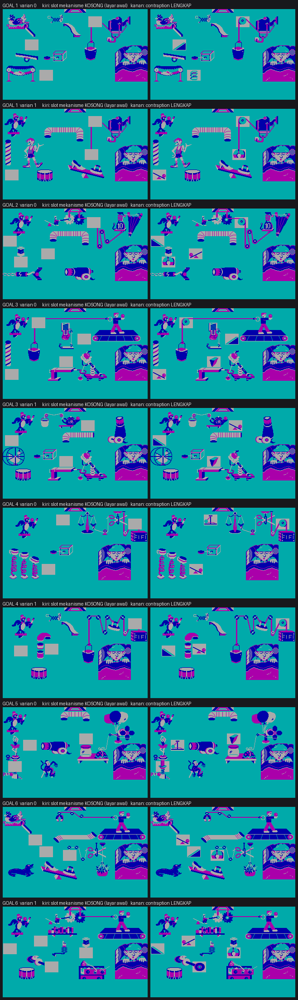
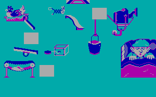
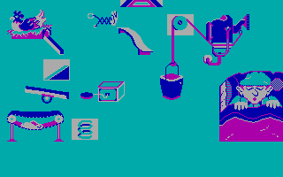

# CREATIVE CONTRAPTIONS

## *Bangun mesin paling konyol yang pernah berhasil.*

### Bantam Electronic Publishing · 1985 · IBM PC

---

> **Ada bola yang jatuh dari langit-langit.**
> Ada tuas, katrol, bidang miring, pegas, dan bandul.
> Ada ayam jago, drum, balon, dan seseorang yang tidur nyenyak di ranjangnya.
>
> Tugasmu sederhana: **bangunkan dia.**
> Caranya sama sekali tidak sederhana.

Ini bukan game tentang refleks. Ini game tentang **sebab dan akibat** — tentang
menyusun rantai kejadian sampai bola yang jatuh di pojok kiri atas akhirnya, entah
bagaimana, membunyikan alarm di pojok kanan bawah.

Tujuh tahun sebelum *The Incredible Machine*, game ini sudah mengajukan pertanyaan yang
sama: **apa jadinya kalau fisika dijadikan mainan?**

---

## Enam mesin. Enam masalah sepele. Nol cara masuk akal untuk menyelesaikannya.

| # | Kontraption | Misinya |
|---|---|---|
| 1 | **Up & At 'Em!** | Membangunkan orang yang tidur pulas |
| 2 | **Hair Care** | Urusan rambut dan berdandan |
| 3 | **Easy Eating** | Menyuapi tanpa mengangkat tangan |
| 4 | **Dog Days** | Sesuatu yang melibatkan anjing |
| 5 | **Cool It** | Mendinginkan yang kepanasan |
| 6 | **Lights Out!** | Mematikan lampu — dari jauh |

Setiap kontraption adalah teka-teki rantai. Bola berguling di bidang miring, menabrak
tuas, tuas mengungkit beban, beban menarik katrol, katrol melepas pegas — dan begitu
seterusnya sampai misinya tercapai. **Satu potong salah, seluruh rantai gagal.**

---

## Empat cara bermain

### 1 · REVIEW MECHANISMS — kelas kecilnya

Ensiklopedia interaktif. Tiap mekanisme dijelaskan, diberi contoh dari dunia nyata, dan
— ini bagian terbaiknya — **tekan SPACE untuk melihatnya bergerak.**

Layar PENDULUM, misalnya, menjelaskan "batang menggantung yang berayun bebas maju-mundur",
lalu menyebut jam bandul dan jam kuckuk sebagai contohnya. Sebuah game 1985 yang
benar-benar mengajar, bukan sekadar menantang.

### 2 · FILL IN MECHANISMS — belajar sambil membangun

Semua hiasan sudah terpasang; **semua mekanismenya hilang.** Kotak-kotak abu menandai
lubang yang harus kamu isi. Pilih part, pasang, jalankan bola, lihat apakah rantainya
hidup.

### 3 · FILL IN ZANY OBJECTS — kebalikannya

Kali ini mesinnya utuh dan **objek-objek konyolnya** yang hilang. Pilihannya berputar
di dalam kotak yang berkedip, bukan di strip bawah layar.

### 4 · CONTRAPTION MIX UP — pertandingan sesungguhnya

Berwaktu. Berskor. Kedua jenis part hilang sekaligus, dan **sebagian part yang
ditawarkan memang salah.** Ini mode yang membuat orang mengulang.

---

## Berapa banyak yang sebenarnya bisa dimainkan?

Pertanyaan ini punya jawaban yang lebih menarik daripada "enam level".

**Enam kontraption**, dan sebagian punya lebih dari satu susunan:

| Kontraption | Susunan berbeda |
|---|---|
| 1 · Up & At 'Em! | 2 |
| 2 · Hair Care | 1 |
| 3 · Easy Eating | 2 |
| 4 · Dog Days | 2 |
| 5 · Cool It | 1 |
| 6 · Lights Out! | 2 |
| **Total** | **10 susunan** |

Ditambah **9 demo terpisah** untuk mode Review Mechanisms — satu peragaan per mekanisme.

Tapi angka 10 itu belum cerita lengkapnya. **Setiap kali kamu memuat sebuah kontraption,
game mengocok ulang part yang ditawarkan** — termasuk part pengecoh. Jadi susunan yang
sama tidak pernah terasa persis sama dua kali. Ditambah dua tingkat kesulitan, satu game
1985 berukuran 25 kilobyte ini menyimpan jauh lebih banyak permainan daripada yang
terlihat dari daftarnya.



**Penjelasan gambar.** Kesepuluh susunan mode *Fill in Mechanisms*, satu baris per
susunan. **Kiri**: layar seperti yang kamu temui pertama kali — kotak abu adalah slot
mekanisme yang harus kamu isi. **Kanan**: kontraption yang sama setelah semuanya
terpasang benar.

Perhatikan bahwa Goal 1 dan Goal 3 masing-masing punya dua baris: itulah dua susunan
berbeda untuk kontraption yang sama. Objek hiasannya bergeser, jumlah slotnya berubah,
dan solusinya ikut berubah.

> Gambar-gambar ini **tidak** diambil dari layar game. Semuanya disusun ulang dari
> berkas data aslinya oleh program terpisah, sebagai bukti bahwa struktur internal game
> ini sudah dipahami sepenuhnya. Detailnya di `ARCHITECTURE.md`.

---

## Sembilan mekanisme sederhana. Kemungkinan yang tak sederhana.


**Penjelasan gambar.** Seluruh isi berkas `MECHS` — 15 bentuk yang mengelompok menjadi
9 tipe mekanisme, lengkap dengan nomor id internalnya. Dari kiri atas: bidang miring
(dua bentuk), katrol (tiga bentuk), roda-dan-poros, baji, bandul (dua bentuk), magnet,
sekrup, tuas (dua bentuk), dan pegas.

Kenapa 15 bentuk untuk 9 tipe? Karena beberapa mekanisme punya **arah** — katrol yang
menghadap kiri dan kanan, tuas yang miring ke dua sisi. Saat kamu memilih "katrol", game
memilihkan bentuk yang cocok dengan posisinya.

Satu keanehan kecil yang ikut ketahuan saat membedah berkasnya: **bandul bentuk kedua
(id 131) ada di dalam game tapi tidak pernah dipakai di kontraption mana pun.** Ditandai
merah di gambar — sebuah part yang dibuat, dikirim bersama game, lalu tidak pernah
dijumpai pemain.

Ini persis sembilan mesin sederhana yang diajarkan di pelajaran fisika sekolah. Layar
pembuka mode Review menyatakannya terang-terangan: *"Here are the simple mechanisms that
will be used in this game."* Game ini memang dijual sebagai mainan pendidikan — dan
tidak malu-malu soal itu.

---

## Dan objek-objek konyol yang membuatnya hidup


**Penjelasan gambar.** Isi berkas `GRAPH`: **70 objek "zany"** yang menjadi hiasan dan
pemicu di sepanjang kontraption. Ada drum, timbangan, balon, gunting, kucing, anjing,
ayam jago, cangkir teh, meriam, tempat tidur — masing-masing dengan nomor id-nya, dan
angka **varian** yang menunjukkan berapa bentuk berbeda yang dimiliki objek itu.

Objek-objek inilah yang mengubah teka-teki mekanika menjadi lelucon visual. Sebuah tuas
hanyalah tuas; tuas yang melontarkan seekor kucing ke atas drum adalah *Creative
Contraptions*.

---

## Satu layar, dari kosong ke hidup

| Sebelum | Sesudah |
|---|---|
|  |  |

**Penjelasan gambar.** Kontraption **Up & At 'Em!**, susunan pertama.

**Kiri** — layar awal. Corong bola di puncak tengah, orang yang tidur di kanan bawah
sebagai tujuan, dan **tiga kotak abu**: itulah mekanisme yang harus kamu pilih dan
pasang.

**Kanan** — kontraption yang sama setelah lengkap. Di slot kiri-atas kini ada bidang
miring; di tengah-bawah sebuah pegas; di kanan-atas sebuah katrol. Bola akan jatuh dari
corong, meluncur, memantul, dan berakhir di ranjang.

Jarak antara dua gambar inilah keseluruhan permainannya.

---

## Dua tingkat, dua permainan berbeda

| | **Apprentice** | **Master Builder** |
|---|---|---|
| Part yang ditawarkan | Semua **benar** — tinggal soal penempatan | **Campuran** benar dan salah |
| Jumlah pengecoh | Sedikit | Banyak |
| Waktu | Longgar (~5,5 menit) | Ketat (~2,5 menit) |
| Jumlah bola | **Tak terbatas** | Hanya **6** |
| Huruf bonus | — | **Ada** |

Apprentice mengajarkan cara berpikir. Master Builder menguji seberapa cepat kamu bisa
melakukannya di bawah tekanan — dengan part-part yang sengaja menipu.

---

## Kontrol

Versi DOS memakai **tombol panah** — layarnya sendiri yang memberi tahu:
*"Press ↓ or ↑ to move box"* dan *"Press ← or → to review the contraption parts"*.

| Tombol | Fungsi |
|---|---|
| ← → | Memutar pilihan part |
| ↑ ↓ | Berpindah antar kotak kosong |
| ENTER | Memasang part yang terpilih |
| SPACE | Menjalankan bola |
| ESC | Kembali ke menu |

> **Catatan bagi yang membaca manualnya.** Manual yang beredar adalah versi **Apple II**
> dan menyebut tombol J/K dan M/I. Versi DOS tidak memakainya. Ini perbedaan
> antar-platform nyata yang hanya bisa diketahui dengan menjalankan versi DOS-nya
> sendiri.

---

## Skor

| Pencapaian | Poin |
|---|---|
| Part benar pada percobaan pertama | **10.000** |
| ...percobaan kedua | 5.000 |
| ...lebih dari dua kali | 2.500 |
| **Kontraption utuh benar pada percobaan pertama** | **100.000** |
| ...percobaan kedua | 50.000 |
| ...lebih dari dua kali | 25.000 |
| Tiap satuan waktu yang tersisa | 1.000 |
| Tiap bola yang tidak terpakai | 25.000 |
| Huruf bonus (Master Builder) | A = 10.000, B = 20.000, C = 30.000, ... |

**Tiap part hanya dinilai sekali** — tidak ada cara memutar ulang untuk menumpuk poin.
Seperti kata layarnya sendiri: *"Race against the clock... The fewer mistakes you make,
the higher your score will be."*

### Huruf bonus, dan kenapa harus diperhatikan

Di Master Builder, salah satu huruf di layar berubah warna. Jalankan kontraption saat
huruf itu **KAPITAL** dan kamu dapat poin tambahan. Jalankan saat huruf itu **kecil**
dan kamu dapat poin **plus satu bola gratis**.

Huruf kecil muncul sebentar di awal, lalu **muncul lagi tiga sampai empat kali di
tengah permainan tanpa peringatan.** Pemain yang jeli menunggu momen itu.

---

## Tiga tips yang benar-benar mengubah hasil

1. **Kegagalan hanya menunjukkan kesalahan PERTAMA.** Kalau bola memantul liar, kotak
   yang berkedip adalah kesalahan paling awal di rantai — bukan satu-satunya. Perbaiki
   itu dulu, jalankan lagi, baru lihat kesalahan berikutnya.
2. **Baca hurufnya, bukan gambarnya.** Huruf A, B, C di layar menunjukkan **urutan
   kerja** rantai. Ikuti urutannya dan sebagian besar slot akan menjelaskan dirinya
   sendiri.
3. **Di Master Builder, curigai part yang terlalu cocok.** Pengecoh sengaja dibuat
   masuk akal secara visual. Tanyakan apa yang harus terjadi *setelah* part itu, bukan
   apakah ia pas di kotaknya.

---

## Kisah di balik layar

### Penerbit yang hanya hidup satu tahun

**Bantam Electronic Publishing** adalah cabang perangkat lunak dari penerbit buku Bantam.
Divisi ini berumur pendek, dan sebagian besar katalognya nyaris tak berbekas. *Creative
Contraptions* adalah salah satu yang selamat.

### Looking Glass Software — dan salah paham yang wajar

Pengembangnya bernama **Looking Glass Software, Inc.**

⚠ **Ini bukan** Looking Glass Studios, pembuat *System Shock* dan *Thief*. Kesamaan
namanya kebetulan. Looking Glass Studios berakar pada Blue Sky Productions (1990) dan
Lerner Research — tidak ada hubungannya dengan Bantam maupun 1985. Kekeliruan ini cukup
sering muncul sehingga layak disebutkan terang-terangan.

### Nama yang nyaris hilang

Selama puluhan tahun, tidak ada catatan publik tentang siapa yang menulis game ini.

Nama itu ada di dalam programnya sendiri, hanya saja tersembunyi: berkas `CONTRAP.EXE`
dimampatkan dengan PKLITE, jadi teks di dalamnya tidak terbaca oleh alat biasa. Setelah
dibuka, sebuah baris muncul:

```
Programmed by:  Jessie Ragsdale
```

Bersamanya muncul pula **keenam nama kontraption** — lima di antaranya sebelumnya tidak
tercatat di mana pun.

---

## Dari mana fakta di halaman ini berasal

Halaman ini adalah brosur, tapi bukan iklan: setiap angkanya bisa diperiksa.

- **Dimainkan langsung** — mode, layar, tombol, dan perilaku game diamati dengan
  menjalankan versi DOS-nya.
- **Manual asli** — tabel skor dan aturan huruf bonus.
- **Dibedah dari binernya** — nama programmer, nama kontraption, jumlah susunan per
  kontraption, isi katalog mekanisme dan objek, dan seluruh gambar layar di halaman ini.

Yang terakhir itu yang paling tidak biasa: source C game ini sudah **direkonstruksi
ulang sampai byte-nya identik** dengan program aslinya, dan layar-layar di halaman ini
disusun ulang dari berkas data mentahnya tanpa menjalankan game sama sekali. Kalau
pemahaman kami keliru, gambar-gambar itu tidak akan pernah tersusun.

Cerita teknis lengkapnya ada di **`ARCHITECTURE.md`** (bagaimana program 1985 dirancang)
dan **`CODE_MAP.md`** (peta kodenya, baris demi baris).

---

## Satu hal yang masih belum diketahui

Manual menjanjikan bonus untuk menyelesaikan keenam kontraption tanpa satu pun
kesalahan — *"skor akan lebih tinggi lagi"* — tetapi **tidak pernah menyebut angkanya**,
dan nilainya belum ditemukan di dalam kode.

Kalau kamu berhasil melakukannya, kamu akan jadi orang pertama dalam empat puluh tahun
yang tahu jawabannya.
