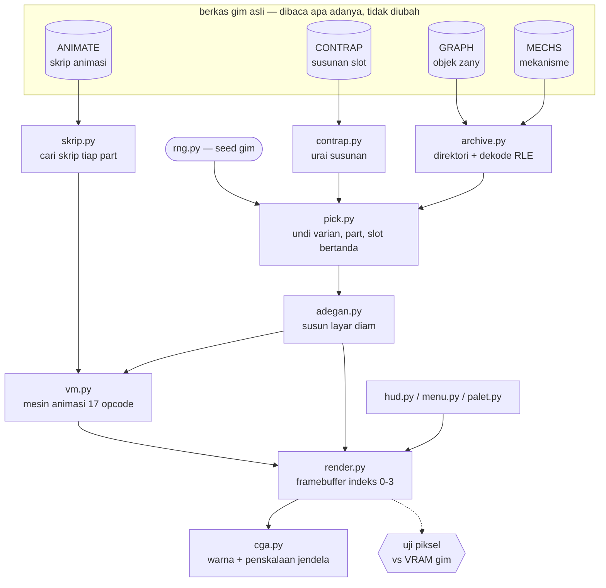
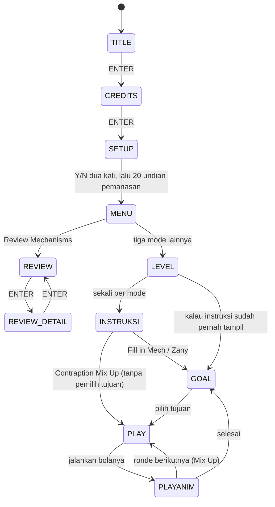

# Dari 1985 ke Python — bagaimana yang lama diterjemahkan

> Untuk siapa dokumen ini: orang yang **belajar pemrograman** dan ingin melihat satu
> program lama dibangun ulang dari nol. Bukan tutorial pygame, dan bukan katalog fungsi
> (itu ada di [`PORT_CODE_MAP.md`](PORT_CODE_MAP.md)).
>
> Pasangannya: [`ARCHITECTURE.md`](ARCHITECTURE.md) menjelaskan **program aslinya**.
> Bacalah itu dulu — dokumen ini berulang kali menunjuk ke sana.

---

## 1. "Port" di sini berarti apa

Kata *port* sering dipakai untuk dua hal yang sangat berbeda:

1. **Menerjemahkan kode** — baris demi baris, C menjadi Python.
2. **Membangun ulang perilakunya** — membaca data yang sama, menjalankan aturan yang
   sama, menghasilkan layar yang sama.

Yang ada di `port/` adalah **yang kedua**. Tidak ada satu baris pun hasil terjemahan
otomatis. Kalau pemahaman kami tentang sebuah aturan salah, gambarnya akan berbeda —
dan itulah gunanya.

Kenapa memilih yang lebih sulit? Karena yang pertama sudah dikerjakan, dan hasilnya ada
di `src_c/`: source C yang dikompilasi ulang menghasilkan `.EXE` byte-identical.
Rekonstruksi itu membuktikan **kodenya terbaca benar**. Ia tidak membuktikan kami
mengerti apa yang kode itu *lakukan* — sebuah program bisa disalin sempurna tanpa
dipahami sama sekali. Untuk itu perlu uji yang berbeda: tulis ulang mesinnya dengan
cara sendiri, lalu adu setiap bingkainya.

```
src_c/   "byte-nya benar"    -> membuktikan pembacaan
port/    "layarnya sama"     -> membuktikan pemahaman
```

### Dari berkas aset ke layar



**Penjelasan gambar.** Baca dari atas ke bawah. Empat berkas gim asli masuk tanpa diubah;
tiga pengurai mengubahnya jadi struktur Python. Yang perlu diperhatikan: kotak `rng.py`
di kiri **ikut menentukan isi layar** — varian mana yang dipakai dan part mana yang
ditawarkan diundi, tidak disimpan, jadi generator acaknya sama pentingnya dengan
berkas asetnya. Semua penggambar bermuara ke satu framebuffer berisi angka 0–3, dan dari
situ jalurnya bercabang: ke kiri-bawah untuk ditampilkan ke pemain, dan ke kanan-bawah
(garis putus-putus) untuk diadu dengan memori layar gim asli. Cabang uji itu membaca
framebuffer yang **sama persis** dengan yang dilihat pemain — bukan salinannya.

---

## 2. Keputusan besar, dan alasannya

### 2.1 Aset asli dibaca saat program berjalan

Port **tidak** mengubah `GRAPH`/`MECHS`/`ANIMATE`/`MISC`/`CONTRAP` menjadi PNG atau JSON.
Ia membuka berkas yang sama seperti gim 1985 dan mendekode isinya saat dibutuhkan.

Kelihatannya menyusahkan diri sendiri — dan memang lebih repot. Tapi akibatnya besar:
**grafisnya setia secara konstruksi.** Tidak ada langkah konversi yang bisa menyisipkan
kesalahan; tidak ada palet yang bisa bergeser; tidak ada sprite yang bisa terpotong satu
piksel. Kalau sebuah gambar salah, penyebabnya pasti aturan yang kami tulis, bukan data
yang sudah rusak sejak diimpor.

Ini juga sebabnya repo tidak berisi gimnya (lihat [`README.md`](README.md)): yang
didistribusikan pembacanya, bukan isinya.

### 2.2 Generator acaknya disalin persis

Isi layar gim ini **tidak disimpan** — ia diundi. Varian mana yang dipakai, part mana
yang ditawarkan, slot mana yang dikosongkan: semuanya hasil `rnd()`. Jadi menyalin
gambarnya tidak ada gunanya kalau undiannya berbeda.

Generatornya sebuah LCG 16-bit:

```python
seed = (seed * 0x3E85 + 0x3619) & 0xFFFF     # cc/core/rng.py
hasil = (n * seed) >> 16                      # kata TINGGI, bukan modulo
```

Dua jebakan yang mahal di sini, dan keduanya tentang *keadaan bersama*:

- `rnd(1)` **selalu** mengembalikan 0 — tapi ia tetap memajukan `seed`. Membuangnya
  sebagai "optimasi" menggeser seluruh undian sesudahnya.
- Fungsi yang hasilnya **tidak terlihat** tetap bisa menentukan segalanya. `setmark()`
  menandai slot; tandanya tak tampak di layar, tapi ia memakai `rnd()` — melewatkannya
  membuat setiap part sesudahnya salah.

> **Pelajaran umum.** Kalau dua bagian program berbagi satu keadaan, urutan pemakaiannya
> ikut jadi bagian dari antarmuka. Ini berlaku jauh di luar gim lama: cache, koneksi
> basis data, dan generator acak modern punya penyakit yang sama.

### 2.3 "Fisikanya" ternyata bukan fisika

Bola yang memantul di sepanjang kontraption terlihat seperti simulasi. Bukan. Ia
**skrip** yang ditafsirkan sebuah mesin virtual kecil dengan 17 instruksi
(`animvm()` di gim, `cc/core/vm.py` di port). Lintasan parabolanya pun bukan gravitasi
melainkan satu interpolator yang dipanggil dengan titik awal, titik akhir, dan
lendutan.

Kalau kami mengira ini physics engine dan menulis simulasi, hasilnya akan *terlihat
masuk akal* dan **tidak pernah cocok**. Yang menyelamatkan bukan ketelitian membaca
assembly, melainkan mengukur: merekam setiap penulisan memori, lalu membandingkan.

### 2.4 Framebuffer indeks-warna, bukan Surface

Gim menggambar ke mode CGA 4: 320×200, **empat warna**, dua bit per piksel, baris genap
dan ganjil di dua bank memori terpisah.

Port memakai framebuffer `list[200][320]` berisi angka **0–3** — indeks warna, bukan
RGB. Pewarnaan dan penskalaan baru terjadi di ujung, saat ditampilkan.

Alasannya bukan kerapian melainkan **kemampuan diuji**: perbandingan dengan gim asli
jadi perbandingan angka, bukan piksel RGB yang bisa meleset karena pembulatan. Seluruh
angka "64.000/64.000" di dokumen ini mungkin karena keputusan ini.

### 2.5 Satu penggambar, dua kanvas

Kode HUD, menu, dan strip part ditulis **sekali**, lalu dijalankan di atas dua kanvas:

| kanvas | dipakai untuk |
|---|---|
| `KanvasFB` | framebuffer indeks — dipakai uji piksel |
| `KanvasSurface` | `pygame.Surface` — dipakai layar sungguhan |

Kalau kode itu ditulis dua kali, uji akan menguji **salinan yang salah**: yang diuji
bukan yang dilihat pemain. Ini bukan masalah teoretis — ia benar-benar terjadi sekali di
proyek ini, dan pasalnya ada di §5.

### 2.6 Dua jalur teks, karena aslinya memang dua

Gim menulis teks lewat **dua** jalur yang berbeda, dan keduanya memakai font berbeda:

| jalur | font | dipakai untuk |
|---|---|---|
| `text()` | font gim, tersimpan di segmen datanya | menu, nama tujuan, petunjuk |
| `printf()` | **font ROM BIOS**, lewat DOS | pesan dalam permainan |

Menyeragamkannya jadi satu font akan lebih rapi — dan salah. Port menirunya apa adanya:
`cc/core/font.py` untuk yang pertama, `cc/core/dosfont.py` untuk yang kedua.

Bagian ini punya cerita sendiri. Karena pesan itu keluar lewat DOS, **warnanya dan
bentuk hurufnya tidak ditentukan gim sama sekali** — tidak ada apa pun di binernya yang
bisa dibaca untuk menjawabnya. Jawabannya diperoleh dengan menulis program DOS 69 byte
yang mencetak lewat jalur yang sama lalu membuang isi memori layarnya ke berkas,
dijalankan di emulator. Warnanya ternyata 3, dan baris teksnya 22.

> **Pelajaran umum.** Kalau sebuah pertanyaan tidak terjawab oleh sumber yang sedang kamu
> baca, kadang jawabannya bukan "baca lebih teliti" melainkan "ukur di tempat lain".

---

## 3. Peta padanan

Bentuk programnya sengaja dibuat sejajar dengan aslinya, supaya keduanya bisa dibaca
berdampingan.

### Alur layar



**Penjelasan gambar.** Mesin keadaan `port/main.py`, dan bentuknya mengikuti gim aslinya
termasuk hal-hal yang terlihat janggal. Tiga di antaranya sering salah ditebak. Pertama,
**`SETUP` bukan sekadar layar tanya-jawab**: sesudah pertanyaan kedua ada 20 undian
pemanasan yang hasilnya dibuang — tapi seed-nya maju, jadi seluruh pemilihan part di
permainan bergantung padanya. Kedua, **Contraption Mix Up melompati `GOAL`**: mode itu
tidak memakai pemilih tujuan sama sekali, ia memainkan keenam kontraption berurutan.
Ketiga, panah `LEVEL → GOAL` yang langsung ada karena layar instruksi hanya muncul
**sekali** per mode. Perhatikan juga `PLAYANIM` kembali ke `GOAL`, bukan ke `MENU` —
selesai bermain mengembalikanmu ke pemilih tujuan.

| konsep di gim 1985 | di port | catatan |
|---|---|---|
| `main()` — gelung mode | `port/main.py` | mesin keadaan `TITLE → MENU → LEVEL → INSTRUKSI → GOAL → PLAY → PLAYANIM` |
| `loadcon()` — muat kontraption | `cc/core/contrap.py` + `pick.py` | termasuk gelung penghindar varian |
| `animvm()` — mesin animasi | `cc/core/vm.py` | 17 opcode, satu kursor global |
| `drawball` / `xform` | `cc/core/adegan.py` | urutan prep → blend → putmsk → draw |
| `setsel()` / `show()` — layar bertabel | `cc/core/menu.py` | 12 tabel, satu penggambar |
| `mkpal()` + strip pemilih | `cc/core/palet.py` + `pick.py` | jumlah pilihan berbeda per mode |
| `showsc` / `timedrw` / `hintmark` | `cc/core/hud.py` | skor, timer, penanda petunjuk |
| `rnd()` @0x5A5B | `cc/core/rng.py` | LCG, kata tinggi |
| penangan interupsi timer (bunyi) | `cc/core/bunyi.py` | tiga mode aliran nada |
| `blit` / `fillrect` / `shftr` | `cc/core/render.py` | primitif gambar |

Pemetaan per alamat ada di [`PORT_CODE_MAP.md`](PORT_CODE_MAP.md).

---

## 4. Apa yang sengaja **tidak** dimodernkan

Godaan terbesar saat membangun ulang program lama adalah memperbaikinya. Beberapa hal
sengaja dibiarkan salah, karena yang dikejar tampilan yang **sama**, bukan yang benar:

- **Bug gim aslinya direproduksi.** Satu opcode lemparan meneruskan byte mentah ke
  interpolator tanpa memulihkan tandanya, sementara kembarannya memulihkan. Itu tampak
  seperti kesalahan tahun 1985 — dan ditiru apa adanya, karena memperbaikinya mengubah
  lintasan bolanya.
- **Skor disimpan dibagi sepuluh.** Format cetaknya menempelkan angka nol harfiah, jadi
  nilai internal 10.000 terbaca "100000" oleh pemain. Menyimpan angka tampilannya akan
  membuat skor sepuluh kali lipat.
- **Nama yang menyesatkan dibiarkan, tapi diberi catatan.** Sebuah variabel bernama
  `bally` ternyata menyimpan koordinat **mendatar**. Menggantinya diam-diam akan membuat
  dokumen ini tidak lagi cocok dengan binernya; yang dilakukan adalah menuliskan
  ketidakcocokan itu di tempat ia muncul.

Yang **memang** berubah, karena tidak punya padanan: segmen:offset menjadi objek Python,
interupsi perangkat keras menjadi gelung bingkai, dan bunyi PC-speaker menjadi gelombang
kotak yang disintesis — bentuk kotak, bukan sinus, karena speaker PC memang hanya bisa
menyala atau mati.

---

## 5. Bagaimana port ini diuji

Semua uji mengadu ke **gim asli yang berjalan di emulator**, tidak pernah ke keluaran
port sendiri.

| yang diuji | hasil |
|---|---|
| Animasi 10 varian + layar judul, penuh sampai habis | 1.565/1.565 bingkai · 100.160.000/100.160.000 piksel |
| Pembuka animasi (jam pasir + bilah bola) | 59/59 bingkai |
| Layar bermain: 6 tujuan × 2 mode + 6 ronde Mix Up + jalur pemain | 20 kasus, 64.000/64.000 |
| Menu, level, pemilih tujuan, credits, set-up, 3 layar instruksi | 11 layar, 64.000/64.000 |
| Teks DOS: baris, kolom, warna, bentuk huruf | 64.000/64.000 |
| Bunyi | urutan frekuensi cocok dengan yang ditulis gim ke perangkat kerasnya |

Dan port **tidak membaca satu pun berkas tangkapan**. Itu bukan klaim melainkan uji:
`work/test_mandiri.py` membungkus `open()` sehingga setiap pembacaan di bawah folder
rekaman melempar kesalahan, lalu menjalankan port lewat jalur pemain. Nol pembacaan.

### Empat kesalahan yang paling banyak mengajarkan

1. **Uji lewat modul inti tidak melihat bug di `main.py`.** Layar bermain cocok
   64.000/64.000 lewat modul inti, sementara jalur pemain masih meleset 738 piksel:
   palet dikocok **dua kali** — kocokan gim yang benar, lalu sisa kode lama di atasnya.
   Inilah kenapa §2.5 penting.

2. **Alat ukur bisa membatasi temuan.** Jumlah varian pernah dihitung dari *berapa
   banyak berkas rekaman yang kebetulan ada*, sehingga varian yang belum sempat direkam
   tak pernah terpilih. Yang membuatnya sulit terlihat: **ujinya menghitung dengan cara
   yang sama**, jadi ia ikut membatasi diri dan tidak akan pernah melaporkannya.
   Curigai uji yang memakai sumber data yang sama dengan kode yang diujinya.

3. **Kecocokan piksel tidak selalu membuktikan yang kamu kira.** Satu mode cocok sempurna
   bahkan sebelum sebuah fungsi pengundi ditambahkan — karena di layar itu yang tampak
   kebetulan tidak bergantung pada undian. Yang membuktikan rantai undiannya adalah mode
   lain.

4. **"Jalur kodenya sama" itu argumen, bukan pengukuran.** Empat bagian pernah dibiarkan
   tak diuji dengan alasan itu terdengar cukup. Keempatnya akhirnya diukur — dan
   **keempatnya memunculkan kesalahan**. Bagian yang belum diuji tidak berstatus "hampir
   pasti benar"; ia berstatus *tidak diketahui*.

---

## 6. Kalau kamu ingin melakukan hal serupa

1. **Mulai dari datanya.** Format berkas jauh lebih mudah dipecahkan daripada instruksi
   mesin, dan begitu datanya masuk akal, kodenya ikut masuk akal.
2. **Bangun ulang, jangan cuma membaca.** Membaca membuatmu *merasa* paham; menghasilkan
   layar yang sama *membuktikan* kamu paham.
3. **Siapkan pembanding sebelum menulis kode.** Di proyek ini emulatornya dibuat lebih
   dulu. Tanpa itu, setiap perbaikan hanya akan diadu dengan ingatan.
4. **Curigai angka yang membaik.** Perbaikan yang penjelasannya salah tetap bisa menaikkan
   skor — dan itu justru menyesatkan lebih lama.
