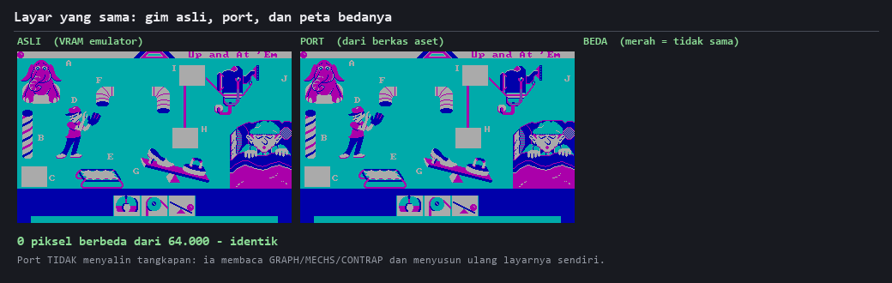

# Creative Contraptions — dibedah, lalu dibangun ulang dua kali

Sebuah gim DOS tahun 1985 dibongkar sampai ke byte terakhirnya, lalu dibangun ulang
**dua kali** dengan dua cara yang sangat berbeda — dan keduanya diuji terhadap gim
aslinya, bukan terhadap harapan kami sendiri.

| | apa itu | bukti |
|---|---|---|
| **`src_c/`** | source C yang, dikompilasi ulang, menghasilkan `.EXE` **byte-identical** | 46.532 dari 46.532 byte; 83/83 fungsi |
| **`port/`** | tulis ulang dalam Python — implementasi baru, bukan terjemahan | 1.565/1.565 bingkai animasi, 100,000000% piksel |

Keduanya dikerjakan sampai selesai. Yang satu membuktikan **kodenya terbaca benar**;
yang lain membuktikan **aturannya dipahami** — dua hal yang sering dikira sama, padahal
tidak.



**Penjelasan gambar.** Tiga panel untuk satu layar yang sama. Kiri: isi memori layar gim
asli, dibaca langsung dari emulator saat gim berjalan. Tengah: layar yang sama disusun
ulang oleh port Python — ia tidak menyalin panel kiri, melainkan membaca berkas aset gim
(`GRAPH`, `MECHS`, `CONTRAP`) lalu menyusunnya sendiri dengan aturan yang sama. Kanan:
peta piksel yang berbeda antara keduanya; merah berarti tidak sama. Panel kanan kosong —
nol dari 64.000 piksel berbeda. Angka di bawah gambar dihitung ulang setiap kali gambar
ini dibangkitkan, jadi kalau suatu saat port meleset, panel kanan akan menyala sendiri.

---

## Gimnya apa

**Creative Contraptions** (1985, Looking Glass Software untuk Bantam Electronic
Publishing — *bukan* Looking Glass Studios) adalah gim edukasi bergaya Rube Goldberg:
kamu menyusun mesin bertingkat dari katrol, tuas, bidang miring, dan pegas, lalu
menjalankan bolanya untuk melihat apakah rantai itu bekerja.

Programmernya **Jessie Ragsdale**. Kompilernya **Microsoft C 1.04** — yaitu Lattice C
yang di-rebrand — dengan model memori SMALL dan `int` 16 bit.

Ceritanya, mode permainannya, dan sejarahnya ada di **[`GAME_GUIDE.md`](GAME_GUIDE.md)**.

## Mulai dari mana

Tiga dokumen ditulis untuk **dibaca**, bukan sebagai catatan kerja. Pilih sesuai
tujuanmu:

| kalau kamu ingin… | baca |
|---|---|
| memahami bagaimana program 1985 dirancang, dan **kenapa** | [`ARCHITECTURE.md`](ARCHITECTURE.md) |
| belajar **membaca kode** orang lain — peta per alamat, format data | [`CODE_MAP.md`](CODE_MAP.md) |
| tahu gimnya sendiri: mode, skenario, sejarah | [`GAME_GUIDE.md`](GAME_GUIDE.md) |
| melihat bagaimana yang lama **diterjemahkan** ke yang baru | [`PORT_ARCHITECTURE.md`](PORT_ARCHITECTURE.md) |
| memetakan fungsi asli ↔ modul port, satu per satu | [`PORT_CODE_MAP.md`](PORT_CODE_MAP.md) |

Kalau kamu baru belajar pemrograman, urutan yang kami sarankan:
**`ARCHITECTURE.md` → `PORT_ARCHITECTURE.md` → `CODE_MAP.md` → `PORT_CODE_MAP.md`.**
Dua yang pertama menjelaskan *bentuk*-nya; dua berikutnya baru masuk ke alamat dan byte.

## Menjalankan

```
python port/import_assets.py     # sekali: salin aset dari salinan gim milikmu
python port/main.py              # jalankan port
```

Regresinya — 23 berkas, semuanya mengadu ke gim asli:

```
for f in work/test_*.py; do python "$f"; done
```

Membangun ulang source C-nya (butuh MS C 1.04 + MASM di `tools/`):

```
pwsh src_c/build/buildall.ps1 ; pwsh src_c/build/link.ps1
python src_c/verify/execmp.py -v
```

## ⚠ Repo ini tidak berisi gimnya

Yang ada di sini **kode dan analisis**. Berkas gim aslinya — `GRAPH`, `MECHS`,
`ANIMATE`, `MISC`, `CONTRAP`, dan `CONTRAP.EXE` — tidak didistribusikan dan
di-`.gitignore`. Creative Contraptions © 1985 Bantam Electronic Publishing.

Kamu perlu menyediakan salinanmu sendiri; `port/import_assets.py` yang menyalinnya ke
tempat yang dibutuhkan. Yang ikut ke repo adalah **pengekstraknya, bukan hasilnya** —
aturan yang sama berlaku untuk font ROM BIOS.

## Cara kerja yang dipakai — dan kenapa

Proyek ini dikerjakan dengan satu aturan yang dibayar mahal beberapa kali:

> **Bandingkan ke sumber kebenaran, bukan ke keluaran sendiri.**

Setiap angka di dokumen-dokumen ini berasal dari mengadu hasil dengan gim asli yang
berjalan di emulator, per piksel dan per bingkai. Tidak ada yang berasal dari
"kelihatannya benar".

Dua pelajaran yang paling sering menggigit, dan keduanya diceritakan lengkap dengan
kegagalannya di `ARCHITECTURE.md`:

- **Angka yang membaik bukan bukti penjelasannya benar.** Beberapa hipotesis menaikkan
  skor kecocokan dengan alasan yang ternyata keliru; yang benar menaikkannya lebih
  tinggi lagi tanpa satu pun penyesuaian.
- **"Jalur kodenya sama" itu argumen, bukan pengukuran.** Empat bagian pernah dibiarkan
  tak diuji dengan alasan itu. Keempatnya akhirnya diukur — dan keempatnya memunculkan
  kesalahan.
