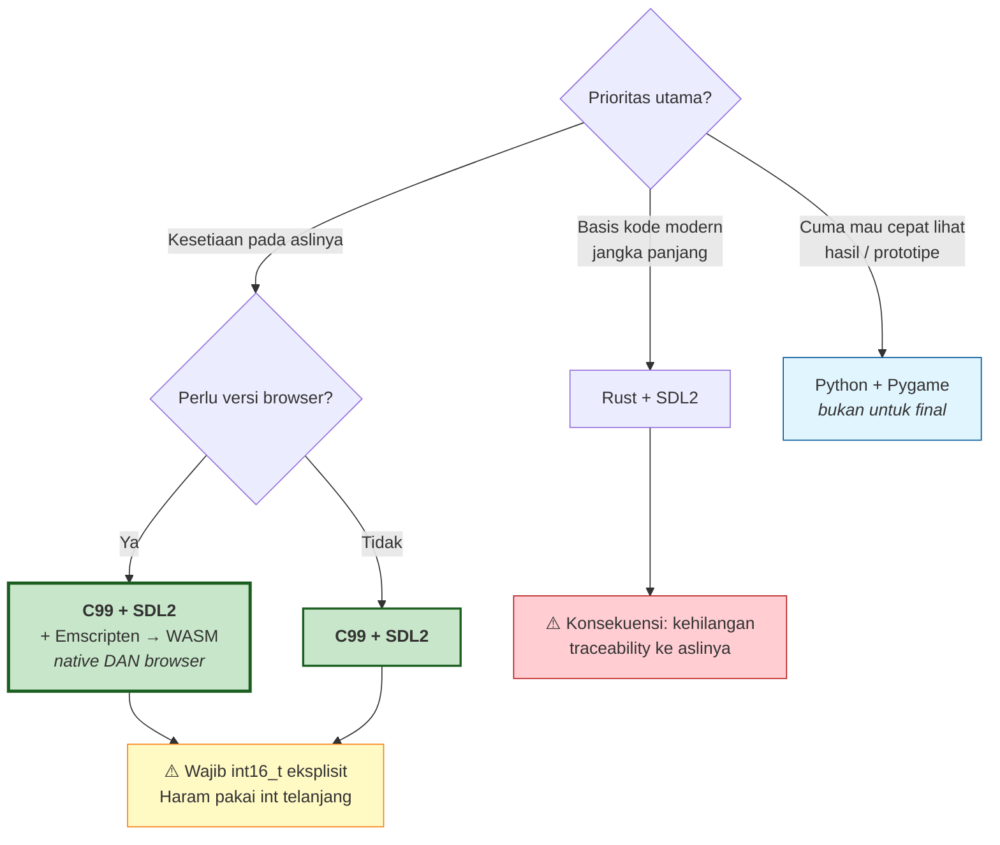

# Pilihan Target Language untuk Port — Pros & Cons

Dokumen pendamping `DECOMPILE_PLAN.md` §Fase 3B.

**Batasan dari Bapak:** tampilan akhir **persis sama**, memakai **aset yang sama**.
Dokumen ini menilai kandidat **khusus terhadap batasan itu** — bukan "bahasa mana yang
terbaik" secara umum.

---

## 1. Kriteria penilaian

Batasan Bapak menghasilkan kriteria yang tidak biasa. Yang **tidak** masuk kriteria:
performa (game 1985 di CPU modern — semua bahasa lebih dari cukup), ekosistem library,
popularitas.

Yang **benar-benar menentukan**:

| # | Kriteria | Kenapa penting di proyek ini |
|---|---|---|
| **K1** | **Traceability ke kode hasil decompile** | Source port bisa dijaga **paralel fungsi-per-fungsi** dengan aslinya. Ini alat verifikasi terkuat kita. Kalau ditulis idiomatik modern, kemampuan mencocokkan **hilang**. |
| **K2** | **Semantik integer 16-bit** | Lattice C `int` = **16 bit**. Salah di sini = bug diam yang mengubah gameplay. |
| **K3** | **Kontrol pixel eksak** | Wajib bisa tulis framebuffer mentah + scaling nearest-neighbor. |
| **K4** | **Kemudahan harness verifikasi** | Perlu dump framebuffer per frame untuk diff vs DOSBox-X. |
| **K5** | **Distribusi / mudah dibagikan** | Bapak ingin melihat & membagikan hasilnya. |
| **K6** | **Keawetan (preservation)** | Ini proyek pelestarian. Toolchain harus tetap bisa di-build 10 tahun lagi. |

> **K1 dan K2 adalah pembeda utama.** Hampir semua bahasa lulus K3–K5. Yang menyaring
> kandidat adalah dua kriteria pertama.

---

## 2. Ringkasan penilaian

| Bahasa | K1 Trace | K2 int16 | K3 Pixel | K4 Harness | K5 Distribusi | K6 Awet | **Total** |
|---|:--:|:--:|:--:|:--:|:--:|:--:|:--:|
| **C99 + SDL2** | ⭐⭐⭐ | ⭐⭐⭐ | ⭐⭐⭐ | ⭐⭐⭐ | ⭐⭐ | ⭐⭐⭐ | **17/18** |
| C++17 + SDL2 | ⭐⭐⭐ | ⭐⭐⭐ | ⭐⭐⭐ | ⭐⭐⭐ | ⭐⭐ | ⭐⭐ | 16/18 |
| Zig + SDL2 | ⭐⭐ | ⭐⭐⭐ | ⭐⭐⭐ | ⭐⭐⭐ | ⭐⭐⭐ | ⭐ | 15/18 |
| Rust + SDL2 | ⭐ | ⭐⭐⭐ | ⭐⭐⭐ | ⭐⭐⭐ | ⭐⭐⭐ | ⭐⭐⭐ | 16/18 |
| C# + MonoGame | ⭐⭐ | ⭐⭐ | ⭐⭐⭐ | ⭐⭐ | ⭐⭐ | ⭐⭐ | 13/18 |
| Go + Ebiten | ⭐⭐ | ⭐⭐ | ⭐⭐⭐ | ⭐⭐ | ⭐⭐⭐ | ⭐⭐ | 14/18 |
| **TypeScript + Canvas** | ⭐ | ❌ | ⭐⭐⭐ | ⭐⭐ | ⭐⭐⭐ | ⭐⭐ | 11/18 |
| Python + Pygame | ⭐⭐ | ❌ | ⭐⭐ | ⭐⭐⭐ | ⭐ | ⭐⭐ | 10/18 |

⭐⭐⭐ sangat baik · ⭐⭐ cukup · ⭐ lemah · ❌ masalah serius

---

## 3. Kandidat satu per satu

### 🥇 C99 + SDL2 — **REKOMENDASI**

**Pros**
- **K1 sempurna.** Kode hasil decompile *adalah* C. Kita bisa menjaga struktur identik —
  nama fungsi, urutan, bahkan bentuk `goto` kalau perlu. Setiap fungsi port bisa
  ditaruh berdampingan dengan aslinya untuk direview.
- **K2 sempurna.** `int16_t`/`uint16_t` eksplisit meniru Lattice C persis, termasuk
  perilaku overflow/wraparound.
- **K6 terbaik.** C99 + SDL2 adalah kombinasi paling stabil yang ada. Kode C99 hari ini
  hampir pasti masih bisa di-compile 20 tahun lagi. Untuk **proyek pelestarian**, ini
  bukan poin kecil.
- **Bonus besar:** `emcc` (Emscripten) mengompilasi ke **WASM** → **dapat versi browser
  gratis**, tanpa menulis ulang sebaris pun. Jadi K5 yang tadinya lemah **teratasi**.

**Cons**
- Manual memory management — tapi untuk game 25 KB dengan aset statis, ini nyaris
  non-isu. Tidak ada alokasi dinamis rumit.
- Tidak ada memory safety. Risiko nyata, tapi terkendali di skala segini.
- Distribusi native perlu build per-platform (teratasi via WASM).

**Kenapa menang:** satu-satunya yang menang **telak di K1 dan K2 sekaligus**, dan lewat
Emscripten kelemahan distribusinya hilang.

---

### 🥈 Rust + SDL2

**Pros**
- **K2 sempurna** — `i16` eksplisit, dan `wrapping_add`/`checked_add` justru **memaksa**
  kita menyatakan niat soal overflow. Untuk meniru wraparound 16-bit, ini malah *lebih
  aman* daripada C.
- Memory safety, tooling modern (`cargo`) yang enak.
- **K6 baik** — ekosistem stabil, WASM juga didukung.

**Cons**
- **K1 lemah — ini yang menjatuhkannya.** Kode decompile berbentuk C dengan pointer
  liar, variabel global, dan struktur "tidak sopan". Menerjemahkannya ke Rust idiomatik
  berarti **merestrukturisasi**, dan begitu direstrukturisasi, **kita kehilangan
  kemampuan mencocokkan port dengan aslinya baris per baris.** Padahal itu alat
  verifikasi utama kita.
- Melawan borrow checker demi meniru kode 1985 yang penuh global mutable state = gesekan
  terus-menerus. Bisa pakai `unsafe` — tapi kalau ujungnya `unsafe` di mana-mana,
  keunggulan Rust hilang dan kita cuma dapat C yang lebih ribet.

**Kapan dipilih:** kalau tujuan bergeser ke *"remake modern yang dirawat jangka panjang"*
dan bukan *"rekonstruksi setia"*.

---

### 🥉 C++17 + SDL2

**Pros**
- **K1 hampir sebaik C99** — C++ menerima hampir semua kode C apa adanya, jadi bisa mulai
  1:1 lalu modernisasi bertahap kalau mau.
- **K2 sempurna**, RAII membantu kerapian.

**Cons**
- Godaan "modernisasi" merusak K1 diam-diam. Sekali pakai `std::vector` menggantikan array
  global, kemampuan diff dengan aslinya mulai kabur.
- **K6 lebih lemah dari C99** — kompleksitas toolchain C++ jauh lebih tinggi, standar
  bergerak lebih cepat.
- Untuk game sesederhana ini, fiturnya mubazir.

---

### Zig + SDL2

**Pros**
- **K2 sangat baik** — integer bit-width eksplisit (`i16`) adalah warga kelas satu, dan
  overflow **ditangkap default** (harus pakai `+%` untuk wrapping). Sangat cocok untuk
  menemukan tempat-tempat yang bergantung wraparound.
- Interop C mulus, cross-compile luar biasa mudah (**K5 kuat**).

**Cons**
- **K6 adalah masalah serius.** Zig **belum 1.0** dan breaking change masih rutin. Untuk
  proyek pelestarian yang harus bisa di-build bertahun-tahun lagi, ini risiko nyata —
  kode Zig hari ini bisa gagal compile tahun depan. Ironis untuk proyek yang justru
  bertujuan melawan pembusukan software.

---

### C# + MonoGame

**Pros** — tooling & debugger sangat enak, cross-platform, `short` tersedia.

**Cons**
- **K2 cukup tapi merepotkan** — `short` di C# otomatis dipromosikan ke `int` dalam
  aritmatika, jadi harus cast terus-menerus. Mudah lupa → bug diam.
- **K1 lemah** — butuh restrukturisasi ke class/OOP.
- Butuh runtime .NET (**K5/K6 menengah**).

---

### Go + Ebiten

**Pros** — kompilasi jadi binary tunggal (**K5 sangat baik**), sederhana, `int16` ada.

**Cons**
- **K1 lemah** — tanpa pointer arithmetic, tanpa union, tanpa `goto` yang leluasa. Kode
  decompile 1985 sangat bergantung pada hal-hal itu. Terjemahannya jadi jauh.
- Ebiten agak "berpendapat" soal render loop — melawannya demi timing eksak itu gesekan.

---

### TypeScript + Canvas

**Pros**
- **K5 terbaik mutlak** — satu URL, siapa pun bisa main. Untuk memamerkan hasil, tak
  tertandingi.
- **K3 sangat baik** — `ImageData` memberi akses pixel mentah.

**Cons — dan ini serius**
- **❌ K2 GAGAL.** JavaScript **tidak punya integer**. Semua angka adalah `double` 64-bit.
  Meniru overflow 16-bit harus manual: `(x << 16) >> 16` di **setiap** operasi aritmatika.
  **Satu saja terlewat = bug diam yang mengubah gameplay dan sangat sulit dilacak.**
  Persis kategori bug yang paling saya khawatirkan di Fase 3B.
- **K1 lemah** — struktur pasti bergeser jauh dari C.
- `BigInt`/`Int16Array` bisa membantu, tapi bikin kode berantakan dan lambat.

> **Catatan penting:** kalau yang Bapak inginkan adalah **versi browser**, jalur yang
> benar **bukan** menulis ulang di TypeScript — melainkan **C99 + Emscripten → WASM**.
> Dapat browser *dan* semantik 16-bit yang benar. Tidak perlu memilih.

---

### Python + Pygame

**Pros** — tercepat untuk prototipe, dan **kita sudah punya decoder aset dalam Python**
(sudah terbukti jalan).

**Cons**
- **❌ K2 GAGAL** — int Python arbitrary-precision, **tidak pernah overflow**. Harus
  di-mask manual di mana-mana.
- Timing tidak deterministik (GC), menyulitkan frame-diff yang eksak.
- **K5 lemah** — distribusi Python ke pengguna awam selalu merepotkan.

**Perannya tetap ada:** Python **sudah dan tetap** jadi alat riset/ekstraksi aset kita.
Hanya saja bukan bahasa untuk port final.

---

## 4. Pohon keputusan

---

## 5. Rekomendasi

> ### **C99 + SDL2, dikompilasi juga ke WASM lewat Emscripten.**

Alasannya ringkas:

1. **Traceability (K1)** — satu-satunya cara menjaga port tetap bisa dicocokkan dengan
   kode aslinya. Ini bukan preferensi gaya; ini **alat verifikasi**. Bapak semula minta
   byte-identical karena ingin bukti mekanis — mempertahankan traceability adalah sisa
   terbaik dari semangat itu.
2. **Semantik 16-bit (K2)** — cocok alami dengan Lattice C, tanpa akrobat.
3. **Distribusi (K5)** — lewat WASM, "kelemahan" C hilang. Native **dan** browser.
4. **Keawetan (K6)** — untuk proyek pelestarian, memilih toolchain paling stabil yang ada
   itu keputusan yang selaras dengan tujuan proyeknya sendiri.

### Aturan wajib (terlepas dari bahasa apa pun yang dipilih)

1. **Haram `int` telanjang.** Selalu `int16_t`/`uint16_t` eksplisit.
2. **Aset dibaca dari file asli saat runtime.** Tanpa konversi perantara.
   Setia **secara konstruksi**, bukan secara usaha.
3. **Nearest-neighbor selalu.** Jangan pernah bilinear.
4. **Harness frame-diff dibangun lebih dulu, sebelum logika game.** Kalau harness-nya
   belakangan, kita akan menumpuk penyimpangan tanpa sadar dan baru tahu saat sudah mahal
   diperbaiki.

---

## 6. Yang masih perlu keputusan Bapak

1. **Aspect ratio.** CGA punya pixel non-persegi (~1:1.2). "Persis sama" bisa berarti:
   - (a) 320×200 apa adanya — **rekomendasi saya** (setia pada isi memori)
   - (b) di-stretch ke 4:3 — setia pada penampakan monitor CRT 1985
2. **Prioritas platform:** native dulu, atau browser dulu? (C99+Emscripten memberi
   keduanya, hanya soal urutan.)
3. **Suara.** Game asli pakai **PC speaker** 🌐. Ditiru juga atau dilewati dulu?
